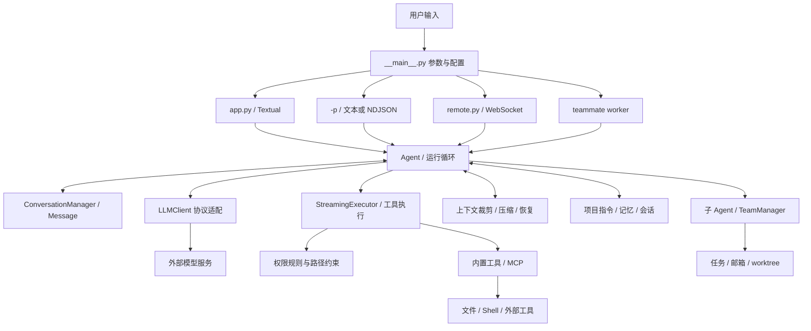

# mewcode-python 项目全景解读

> 历史源码研究：本文及 `analysis/` 内报告保留原快照名称和当时建议。当前用户已确定完整复用实现、仅替换品牌；有效方案见 [StayCode 品牌替换设计](05-staycode-rewrite-design.md)，实际结果见 [验证报告](08-branding-validation.md)。本文的重写判断不再是实施任务。

分析对象：用户提供的本地源码快照；分析日期：2026-09-24。新项目名为 StayCode。本文先描述现有实现，最后给出重写判断。

## 1. 这个项目究竟是什么

mewcode-python 是一个以 Python 实现的终端 Coding Agent。它把大模型的推理与本地文件、命令、会话和协作能力接起来，使模型能够反复执行“理解任务 → 读取环境 → 调用工具 → 看结果 → 继续处理”的循环。

它不是训练模型的项目，也不是仅把用户消息转发给模型的聊天 UI。模型由外部服务提供；项目的主要价值在模型调用之外的编排和工程系统：权限、工具、上下文预算、消息序列化、文件修改、后台任务、团队通信和运行恢复。

现有实现已经有大量功能，但“存在对应类或文件”不等于“所有入口都接线完整”。尤其需要区分 TUI、`-p` 非交互模式、Remote 模式、短期子 Agent、常驻队友这几条实际执行路径。

## 2. 规模与交付物

| 项目 | 本地事实 |
|---|---|
| 总文件数 | 208 |
| 产品 Python 文件 | 141 个，23,427 行 |
| 测试相关 Python 文件 | 37 个，10,551 行 |
| 测试函数 | AST 统计 674 个 `test_` 定义；参数化展开后的数量不同 |
| 包声明 | `mewcode`，`pyproject.toml` 版本 0.2.0 |
| Python 要求 | `>=3.11` |
| CLI 入口 | `mewcode.__main__:main` |
| 界面 | Textual TUI；另有嵌入 HTML/JavaScript 的 Remote 页面 |
| 模型协议 | Anthropic、OpenAI Responses、OpenAI-compatible Chat Completions |
| 持久化 | JSON/JSONL/Markdown 文件，非统一数据库 |
| Git 状态 | 提供的两个目录都没有检测到 Git 仓库 |

最大文件分别为 `app.py`（2,095 行）、`agent.py`（1,410 行）、`web_content.py`（808 行）、`remote.py`（787 行）和 `context/manager.py`（775 行）。这些体量本身不证明设计错误，但结合其中同时承担组装、状态管理和交互的事实，说明拆分职责会有实际收益。

## 3. 整体架构

这张图表示逻辑关系；并非所有前端都经过完全相同的初始化代码。现有项目的一个关键技术债，就是逻辑上相同的职责在多个入口重复组装。

## 4. 一次“帮我修改代码”如何流转

1. **启动和配置。** CLI 解析模式，按用户级、项目级、本地项目配置加载 Provider 和扩展。TUI、单次提示、远程服务、队友 worker 分别进入自己的初始化路径。
2. **组装执行环境。** 创建模型客户端、工具注册表、权限检查器、会话对象和上下文管理器；部分入口还组装 Skills、团队管理、worktree 和文件历史。
3. **形成消息。** 用户任务进入 `ConversationManager`，环境、项目指令、长期记忆和技能目录作为上下文注入。这里存在“用 user 消息包裹系统提醒”的实现约定，不能把消息角色与内容可信度混为一谈。
4. **准备模型请求。** 根据当前协议序列化消息和工具 schema，修复缺失的工具结果配对，考虑缓存标记和上下文预算。
5. **消费流式响应。** 模型可能输出文字、thinking、工具名和工具参数。流式 delta 用于即时显示；完整工具参数到达后才具备执行条件。
6. **执行工具。** 检查工具可用性、参数、权限，再执行文件操作、命令或外部 MCP。部分只读工具可并发，写入操作通常需要串行；现有“只读”分类存在过宽问题，不能直接继承。
7. **结果回写。** 工具结果与调用 ID 配对写回对话。大结果可以溢写到文件，以摘要和引用进入上下文。
8. **继续循环。** 模型看到工具结果再决定下一步。错误、拒绝、取消和上下文溢出分别应有终止或恢复路径；实际各入口存在差异，详见核心报告。
9. **输出与持久化。** 显示最终文本，保存会话记录；部分路径还提取记忆或向主 Agent 发送子任务通知。

例如修改一个 Python 函数，需要先读文件、定位相关代码、生成编辑调用、获得必要授权、写入、运行测试，再依据输出确认结果。“模型说修改好了”本身不是修改成功的证据。

## 5. 子系统地图

| 模块 | 主要职责 | 与其他模块的关系 | 深入阅读 |
|---|---|---|---|
| `__main__.py` | 四类入口、CLI 输出、worker | 组装核心对象 | 报告 01 |
| `app.py` / 对话组件 / `styles.tcss` | 输入、聊天、权限和计划确认、任务进度 | 消费 Agent 事件，也直接维护业务状态 | 报告 01、04 |
| `remote.py` / `web_content.py` | HTTP 页面、WebSocket 双向通信 | 另一套前端与组装路径 | 报告 01、02 |
| `agent.py` | 主循环、工具调度、权限事件、恢复 | 系统枢纽 | 报告 01 |
| `client.py` / `serialization.py` | 协议适配、流事件和消息转换 | 将内部消息转换为外部 SDK 请求 | 报告 01 |
| `conversation*.py` | 内部消息、token 锚点、工具调用配对 | 模型请求与会话恢复的共同输入 | 报告 01 |
| `context/` | 上下文预算、溢写、压缩、恢复 | 调用模型摘要，改变可见历史 | 报告 01 |
| `tools/` | 文件、命令、用户交互、任务和转发工具 | 从 schema 到执行结果 | 报告 02、03 |
| `permissions/` / `sandbox/` | allow/ask/deny、路径和 OS 隔离 | 前者是应用决策，后者主要包裹 Shell 进程 | 报告 02 |
| `mcp/` | 外部工具连接、封装、发现与延迟加载 | 进入工具注册表 | 报告 02 |
| `skills/` | 技能发现、解析、加载和执行 | 修改提示上下文或启动子 Agent | 报告 02 |
| `hooks/` | 生命周期与工具事件上的扩展动作 | 命令、HTTP、提示等动作 | 报告 02 |
| `agents/` | 短期子任务、上下文 fork、追踪和通知 | `AgentTool` 启动新 Agent | 报告 03 |
| `teams/` | 常驻队友、任务共享、邮箱、终端后端 | 可同进程或独立终端进程 | 报告 03 |
| `worktree/` | 创建、进入、退出、检查和清理 Git worktree | 提供独立工作目录，不等于文件沙箱 | 报告 03 |
| `memory/` | 项目指令、会话、记忆提取/召回/整理 | 保存内容并重新加入后续上下文 | 报告 03 |
| `filehistory/` | 修改前备份与回退 | 与编辑工具、轮次快照关联 | 报告 02 |
| `commands/` | 用户斜杠命令和 Markdown 命令 | 操作状态或生成提示 | 报告 04 |
| `config.py` / `validator.py` / `prompts.py` / `crashlog.py` | 配置、校验、提示与异常日志 | 横贯各入口 | 报告 01、04 |

报告编号对应 README 中的链接。全部 208 个文件另有逐项索引，附带资源也包含在内。

## 6. 几组容易混淆的概念

**工具与斜杠命令。** 工具由模型按照 schema 调用，例如读文件；斜杠命令由用户输入，例如 `/session`。前者进入工具执行链，后者往往直接调用本地服务。两者需要统一业务服务，但不必使用同一种输入协议。

**Skill 与 MCP。** Skill 主要提供知识、流程和提示内容，也可以 fork 子任务；MCP 提供外部服务暴露的具体工具。Skill 不是天然隔离的代码插件，MCP 也不是天然安全的只读服务。

**子 Agent 与队友。** 子 Agent 更接近有起止时间的委派任务；队友是加入团队、通过邮箱与共享任务协作的长期执行者。两者都调用模型，但生命周期、通信和持久化需求不同。

**会话、上下文和长期记忆。** 会话是保存的历史；上下文是这次发给模型的内容；长期记忆是跨轮或跨会话复用的知识。压缩上下文不应等同于永久删除原始会话。

**权限、沙箱与 worktree。** 权限决定一次动作能否执行；沙箱限制操作系统资源；worktree 隔离 Git 工作目录。一个 worktree 里的进程仍可能访问外部文件，不能将其当成 OS 安全边界。

**文件回退与 Git。** 文件历史负责特定工具修改的备份，未必覆盖 Shell、MCP 或外部编辑；Git 负责版本控制。现有回退机制不能当成任意操作的事务撤销。

## 7. 值得保留的设计

- 将文本 delta、工具调用和流结束用量统一为内部事件，有利于多个模型协议共用核心。
- 用调用 ID 维护工具请求和结果配对，恢复时处理缺失结果，关注了真实 Agent 常见的中断场景。
- 基于真实 API 用量建立 token 锚点，再估算新增内容，比只用固定字符比例更合理。
- 工具大输出溢写、上下文压缩、MCP 延迟加载解决了上下文成本问题。
- 对权限拒绝附带反馈，而非只有 yes/no，能让模型理解用户希望怎样调整。
- 子任务追踪、团队邮箱、项目指令分层、会话恢复已有可参考的行为与测试。

保留的是经过验证的需求和契约；不能把现有实现中的所有细节视为必须兼容。

## 8. 重写的主要理由

核心问题不是 Python 语言，也不只是“文件太大”。真正的重写收益是统一行为边界：同一任务从 TUI、CLI、子 Agent 进入，应该经过相同的权限、工具执行、上下文恢复和持久化流程。现有重复实现使某些扩展仅接入一条路径，另一条路径遗漏或语义不同。

同时，计划取消被当作批准、Shell 只读判断过宽、工具转发绕过正常执行链、文件回退语义错误、团队持久化和运行句柄分离等问题，都适合以清楚的领域模型和回归测试重新建立行为约束。

建议采用“新目录独立重写，按完整用户流程逐步交付”。P1 交付能修改文件、执行验证和取消的单 Agent CLI；P2 补齐会话恢复与检查点，再逐步添加 TUI、扩展和多 Agent。详细设计见 [重写设计](05-staycode-rewrite-design.md)。

## 9. 学习源码的顺序

1. `tools/base.py`、`conversation.py`：先认识数据。
2. `__main__.py`、`config.py`：理解怎么组装。
3. `client.py`、`serialization.py`：看模型边界。
4. `agent.py`：按一次工具循环读，不必首先钻进全部恢复分支。
5. `tools/read_file.py`、`edit_file.py`、`bash.py` 与 `permissions/`：理解真实副作用。
6. `context/manager.py`、`memory/session.py`：理解长任务与恢复。
7. `app.py`、`commands/`：理解用户交互和事件消费。
8. `agents/`、`teams/`、`worktree/`：理解复杂协作。
9. `mcp/`、`skills/`、`hooks/`、`memory/` 其余部分：理解扩展和跨会话能力。
10. 对照测试与专题问题清单，再看 StayCode 的模块边界如何消除这些耦合。

本轮没有验证真实模型、真实 MCP、远程浏览器交互或跨平台完整行为。33 个通过的测试和失败的全量收集结果详见 [验证报告](analysis/04-interface-and-validation.md)。
