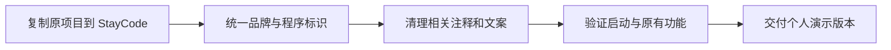

# StayCode 品牌替换设计

状态：用户已确认并要求实施。本文替代此前独立重写与架构重构方案。

## 目标与计划图

完整复用 mewcode 的框架、模块、功能和实现，在 StayCode 目录建立个人演示版本，仅调整名称、相关标识和文案。改名前后行为一致是本次验收标准。

## 命名映射

| 原标识 | 新标识 |
|---|---|
| MewCode | StayCode |
| mewcode 包、命令及品牌标记 | staycode |
| .mewcode | .staycode |
| MEWCODE.md / MEWCODE.local.md | STAYCODE.md / STAYCODE.local.md |
| MEWCODE_* | STAYCODE_* |
| MewCodeApp | StayCodeApp |

同一映射用于普通导入、字符串资源定位、构建元数据、锁文件根包、子进程命令、主题、提示词、配置与保护路径、隐藏技能、测试 patch 路径及断言。

## 复用与内容规则

原 `agent`、`client`、`app`、`tools`、`permissions`、`sandbox`、`context`、`memory`、`mcp`、`skills`、`hooks`、`agents`、`teams`、`worktree`、`commands` 和 Remote 等模块及职责全部保留。不采用此前建议的新模块名称或边界。

保留原工具名、CLI 参数、配置字段、事件字段、存储格式、依赖和版本。实际目录随品牌切换，不提供旧路径回退或数据迁移。

删除重复宣传页眉，来源集中保存在[来源说明](../THIRD_PARTY_NOTICES.md)；技术注释只替换品牌，LICENSE 原文保留。提示词只替换身份名称，不修改行为要求。更新 README 和 [AGENT.MD](../AGENT.MD)，既有源码分析作为历史参考。

## 验收

源文件哈希不变、目标文件完整、品牌归一化后的 Python AST 一致、产品旧品牌残留为零。安装原锁定依赖，验证构建资源、CLI 帮助、TUI 启动和安全回归用例。只修本次改名造成的问题，原有问题单独记录。

实际结果见[验证报告](08-branding-validation.md)。
