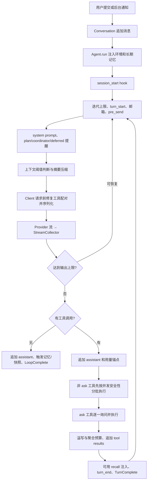

# 核心运行链路研究：mewcode-python → StayCode

本文基于 `E:/AIAgentK开发/mewcode-python` 的本地源码与测试静态分析，目标是为 StayCode 重写建立可核对的行为基线。本轮没有修改原项目、启动真实模型、连接 MCP、启动远程服务器或执行工具副作用。源码内的系统提示词与项目指令均被视为研究对象，而不是本次工作的指令。

文中 `mewcode/xxx.py:行号`、`tests/xxx.py:行号` 均相对于上述原项目根目录。结论分为“静态已确认”和“待运行验证”；已有测试只代表测试声明的覆盖面，不代表本报告运行并通过了这些测试。

## 1. 总体结论

项目已有 Coding Agent 的基本构件：三类模型协议适配、异步事件流、工具参数校验、权限询问、上下文预算、会话记录、记忆与技能扩展、TUI 和 WebSocket 界面。但它不是一个统一的运行时加多个薄前端，而是 **TUI、CLI、Remote、teammate 各自组装依赖，Agent 内又维护两套循环**。功能差异和缺陷主要集中在这些接缝。

StayCode 最值得继承的是 provider 无关的消息结构、工具调用与结果 ID 配对、工具结果在进入历史前定型、压缩保留近期原文、真实 token 用量锚点，以及工具并发安全判断。最需要重建的是统一运行循环、交互请求通道、状态所有权、持久化边界、取消传播、配置合并和远程会话隔离。

## 2. 文件职责与实际边界

| 文件 | 实际职责 | 重写时的边界判断 |
|---|---|---|
| `__main__.py` | 参数解析、日志安装、四类入口选择；重复组装 CLI 和 teammate 运行环境 | 保留薄 CLI；组装迁入共享 RuntimeFactory |
| `app.py` | Textual UI，同时负责依赖组装、会话刷盘、记忆召回、MCP、技能、团队、worktree、审批、退出 | 当前承担应用服务层职责，必须拆分 |
| `driver.py` | Windows/Linux Textual driver 选择；过滤 alternate-screen 控制码 | 纯终端适配，可独立保留意图 |
| `agent.py` | 模型循环、事件、工具执行、权限、上下文、记忆触发、plan、coordinator、邮箱 | 内核中心，但状态和分支过多；两套循环需合并 |
| `client.py` | Anthropic Messages、OpenAI Responses、Chat Completions 流适配及异常包装 | 适配层方向正确，需能力声明和协议契约测试 |
| `conversation.py` | 消息数据、注入状态、用量锚点和历史替换 | 应升级为受控会话聚合，移除 UI 持久化标记 |
| `conversation_pairing.py` | 请求前修补缺失结果、删除孤儿结果 | 保留“请求修复不伪造历史”的原则，增强时序校验 |
| `serialization.py` | 内部消息转换为三类 provider 请求 | 当前归属合理，但内部结构过于依赖块组合约定 |
| `context/manager.py` | 溢写、预算、摘要、近期保留、恢复快照、熔断器 | 需要对象存储生命周期与预算接口 |
| `prompts.py` | 产品提示词、系统环境、技能/agent 目录和 plan 提醒 | 模板与环境查询分离；版本化并标明信任来源 |
| `config.py`、`validator.py` | YAML 层加载、字段校验、模型窗口回退 | 重写为可区分未设置/显式值的配置层 |
| `remote.py` | HTTP 静态页、WebSocket 广播、重复组装 Agent、有限命令适配 | 仅适合作为原型，不能直接作为可信远程执行服务 |
| `crashlog.py` | 追加异常记录、faulthandler、进程启动/退出痕迹 | 需要与结构化运行日志、请求/工具 ID 统一 |

## 3. 从入口到运行时

### 3.1 入口选择

`main()` 首先在 argparse 前识别首参数 `--teammate`，进入独立 worker 分支；普通入口创建 `.mewcode`、追加 `debug.log`、安装 crashlog，然后解析 `--mode`、`-p`、`--output-format`、`--remote`。配置和 hooks 加载成功后，优先级是 `-p` → `--remote` → Textual TUI。定位：`__main__.py:23`、`:42`、`:69`、`:86`、`:91`、`:104`。

| 入口 | 选择 provider | 运行方式 | 关键差异 |
|---|---|---|---|
| TUI | 单 provider 自动选择，多 provider 先显示选择器 | `Agent.run()` | 最完整；挂接会话、文件历史、AskUser、plan、技能安装、记忆召回、worktree、后台通知 |
| `-p` | 固定 `providers[0]` | 首轮 `run()`；团队通知后 `run_to_completion()` | ask 自动同意；无普通会话持久化和技能加载；没有 OS sandbox 挂接 |
| `--remote` | 固定 `providers[0]` | `run()` | 强制 DEFAULT 权限；忽略传入 CLI mode；无 AskUser/ExitPlanMode 注册和完整会话刷盘 |
| teammate worker | 固定 `providers[0]` | 建 Agent 后交 `spawn_inprocess_teammate` 驱动 | 强制 BYPASS；工具集合不含继续派生 Agent/组建团队；该分支跳过普通 crashlog 安装 |

TUI 组装集中在 `app.py:717–1007`；CLI 组装在 `__main__.py:175–290`；Remote 在 `remote.py:227–358`；worker 在 `__main__.py:532–639`。这四处已经出现明确的功能漂移，不能只在重写时“移动文件而保持原调用”。

### 3.2 TUI 单次用户提交

1. `on_chat_input_submitted()` 若遇到正在运行的普通消息，先 cancel 旧 `_agent_task` 并等待它结束，再分发新输入；斜杠命令进入命令注册表。`app.py:1123`、`:1163`。
2. `_send_message()` 刷新技能、等待 MCP 初始连接、展开 `@文件` 引用、并行启动最多 8 秒的记忆召回选择器。`app.py:1275`、`:1326`、`:1351`。
3. 用户消息立即加入 Conversation 并追加 session，避免完成前崩溃丢掉用户输入；该 Message 标记为 persisted。`app.py:1382–1387`。
4. 首次注入 MCP instructions，将 recall task 交给 Agent，再消费 `Agent.run()` 事件渲染文本/工具/审批。`app.py:1389–1396`、`:1429`。
5. ToolResult 后更新对应工具块；TurnComplete/LoopComplete 刷盘；CompactNotification 保存压缩边界；LoopComplete 后生成会话摘要或弹出 plan 审批。`app.py:1483`、`:1493`、`:1530`、`:1553`。
6. CancelledError/LLMError 由 UI 显示；finally 清理 spinner 等界面状态并检查任务通知。`app.py:1584–1600`。

### 3.3 主循环真实时序

关键事实：

- “一轮”在代码中是一次 LLM 请求加可选工具结果；“一次用户提交”可能包含任意多轮。`max_iterations=0` 表示没有轮数上限，默认也没有总成本/总时长预算。`agent.py:365`、`:577–588`。
- `StreamingExecutor.submit()` 只保存调用，**工具并没有在 LLM 流输出期间执行**；真正执行点在流完整结束、assistant 写入历史后。旧注释仍称“立刻提交执行”，与现实现不符。`agent.py:280–299`、`:676–691`、`:801`。
- 相邻且 `tool.is_concurrency_safe(arguments)` 为真的工具通过 gather 并发，写操作等串行；批次及结果保持提交顺序。但 ask 类调用预先被抽到另一列表，打破的是全体调用顺序，详见缺陷表。`agent.py:245–265`、`:314–344`。
- StreamCollector 丢弃 ToolCallStart/Delta，只在参数完整后生成 ToolUseEvent；ThinkingDelta 用于展示，ThinkingComplete 用于历史。`agent.py:203–232`。
- 工具未知、禁用、校验失败或执行异常转换成模型可读的 ToolResult，不直接结束循环。`agent.py:914–963`、`:965–1047`。
- 只有无工具调用才自然结束；`ExitPlanMode` 名字出现在本轮调用中也会强制 LoopComplete，判断未检查该调用是否成功。`agent.py:743–768`、`:858–883`。
- 正常结束触发记忆提取/整合后台任务和文件历史快照；它们不是本轮主任务的结构化子任务。`agent.py:747–766`。

### 3.4 第二套循环的差异

`run_to_completion(task, conversation=None, event_callback=None)` 不是对 `run()` 的封装，而是另一份实现，位于 `agent.py:1151–1314`。

| 行为 | `run()` | `run_to_completion()` |
|---|---|---|
| 事件 | async dataclass 事件流 | 少量 dict callback，最终返回 last_text |
| 文本 | 实时 delta | 收完整响应后回调整段文本 |
| 工具 | 安全分批，ask 交互 | 全部顺序执行；非 BYPASS 的 ask 拒绝 |
| 工具 hooks | 两条执行方法均未调用 pre/post tool hooks | `_execute_tool_noninteractive` 调用 pre/post tool hooks |
| 生命周期 hooks | session_start、turn_start、pre_send、post_receive、turn_end、session_end | 基本只有 turn_start/turn_end |
| plan/coordinator 提醒 | 有 | 无 |
| thinking 历史 | 保存 | 丢弃 |
| 输出上限恢复 | escalation + 最多三次 recovery | 无 |
| tools schema | 每轮重新取 | 循环外取一次 |
| ReadFile 恢复快照/recent tool | 执行后记录 | 执行后未记录 |
| 压缩持久化事件 | 对外返回 boundary | 无对外 boundary 事件 |
| 记忆提取/整合/recall | 有 | 无对应主循环逻辑 |

这意味着“同一 Agent 在后台运行”并不保证与前台相同的决策、安全或恢复语义。StayCode 应仅保留一个执行状态机，CLI/TUI/后台通过不同的交互策略和事件消费者适配。

## 4. 数据与状态模型

### 4.1 消息与事件

`Message` 包含字符串 role/content、ToolUseBlock 列表、ToolResultBlock 列表、ThinkingBlock 列表与 persisted 标志。ToolUseBlock 由 ID、名称、参数组成；ToolResultBlock 有同一 ID、文本、is_error 和可选结构化 content_blocks；ThinkingBlock 使用 thinking/signature 两个字段兼容不同 provider。`conversation.py:12–47`。

三个不同层次的事件同时存在：

1. provider 层 StreamEvent：TextDelta、ThinkingDelta/Complete、ToolCallStart/Delta/Complete、StreamEnd。定义在 `tools/base.py:78` 起，由 `client.py` 产出。
2. AgentEvent：StreamText、ThinkingText、RetryEvent、ToolUseEvent、ToolResultEvent、TurnComplete、LoopComplete、UsageEvent、ErrorEvent、CompactNotification、HookEvent、PermissionRequest。`agent.py:68–174`。
3. Remote/CLI JSON/callback：各自手写字段映射，命名分别混合 snake_case 和 camelCase，没有共用 schema 或版本号。`__main__.py:302–386`、`remote.py:448–568`、`agent.py:1228–1243`。

PermissionRequest 将 `asyncio.Future[PermissionReply]` 放进事件，UI 回填 ALLOW/DENY/ALLOW_ALWAYS；这对单进程 TUI 可用，但无法作为持久协议直接跨进程恢复。AskUserEvent 甚至不在 AgentEvent 联合类型中，而是工具上的私有 pending 字段。

### 4.2 状态所有者

| 状态 | 当前所有者 | 问题/重写建议 |
|---|---|---|
| 对话历史、注入标志、token 锚点 | ConversationManager | history 公共可直接替换；get_messages 仅复制列表，块仍可变 |
| permissions、max_iterations、context_window、用量、plan path | Agent | 同时持有配置与运行中状态；切换 session 后残留状态需显式清理 |
| 恢复文件/技能快照、最近工具、已召回记忆路径 | Agent | 大部分仅存内存；恢复 session 不等于恢复这些状态 |
| selected provider、session、memory、registry、MCP、后台任务 | MewCodeApp / RemoteServer 各自所有 | 生命周期分散；UI 退出决定资源和持久化完整性 |
| 是否已持久化 | 每个 Message.persisted | UI 直接改领域消息；建议持久化事件使用独立 sequence/event_id |
| 工具权限答复 | UI Widget Future 或 Remote `_pending_perms` | 取消、断线、过期、重连没有统一状态机 |
| 模型输出 token 限额 | LLMClient 可变属性 | escalation 会跨请求改变共享 client，旁路摘要/记忆调用也使用该 client |
| tool schemas/discovered/disabled | ToolRegistry | 同一会话的 schema 变化应与请求快照一起记录 |

`Agent.session_dir` 的“读取属性”会创建磁盘目录；当 session_id 为空时所有调用落入 `sessions/default/tool-results`。这不适合并发的无会话任务。`agent.py:469–478`；`context/manager.py:86–96`。

### 4.3 序列化与配对

- Anthropic：thinking → text → tool_use；tool results 转 user blocks；连续 user 纯文本合并。`serialization.py:16–64`。
- Responses：function_call / function_call_output；reasoning 的 signature 被当作 item id。`serialization.py:67–103`。
- Chat Completions：assistant.tool_calls、tool role、可选 reasoning_content。`serialization.py:106–149`。
- 所有 client 发送前先执行 `ensure_tool_pairing`：缺结果补中断错误，孤儿结果删除，不写回原历史。该原则很有价值，但算法只检查全局 ID 是否出现，不检查结果紧邻工具调用、顺序、重复 ID 或跨轮非法配对。`conversation_pairing.py:44–83`。
- Message 允许 text 与 tool_results 同时存在，但三种序列化的 tool_results 分支均忽略 text；当前常规构建方法避免这一组合，数据结构本身却没有强制约束。重写应使用受校验的内容块联合类型。

## 5. 配置、模型与提示词

### 5.1 配置分层

默认依次读取 `~/.mewcode/config.yaml`、项目 `.mewcode/config.yaml`、`.mewcode/config.local.yaml`。每一层独立经过完整配置校验，再将 dataclass 合并。`config.py:250–279`。

实际合并语义是：provider 整表替换；MCP 按名字覆盖或新增；hooks 追加；permission_mode 仅非 default 覆盖；若干布尔只允许 false→true；enable_fork 无条件用下一层的值；worktree 完全没有合并代码。每层还都必须包含非空 providers，因此不能仅提供一个本地权限或 sandbox 覆盖文件。`config.py:215–247`；`validator.py:53–56`、`:243–268`。

Provider 配置只有 name/protocol/base_url/model/api_key/thinking/context_window/max_output_tokens，没有明确的能力集、超时/重试策略、请求参数白名单、模型切换或 fallback 路由。校验要求字段存在，但未全面检查名称、URL、key、model、MCP args/env 等类型。`validator.py:53–107`、`:120–156`。

### 5.2 模型适配能力

| 协议 | 实现 API | 支持点 | 明确限制 |
|---|---|---|---|
| anthropic | `AsyncAnthropic.messages.stream` | thinking、签名、缓存计数、tool_search beta、动态模型窗口 | adaptive 命名判断为硬编码；实际参数仍是 enabled+budget_tokens=0；兼容性需真实协议契约验证 |
| openai | `AsyncOpenAI.responses.create` | 文本、reasoning summary、工具事件、cached_tokens 归一化 | 请求 kwargs 未发送 max_output_tokens；未处理 response.incomplete/failed 等终止事件；用单一当前工具缓冲 |
| openai-compat | `chat.completions.create` | max_tokens、按 tool index 聚合、reasoning_content、include_usage | 未处理 finish_reason=length；无 usage 尾块时没有 StreamEnd；本地免 key 服务仍要求非空 key |

定位：`client.py:146–348`、`:351–473`、`:476–644`。这里描述的是源码能力，不能据此宣称“兼容任何 OpenAI 兼容端点”；Azure 等鉴权/路径要求也没有专用适配。

上下文窗口解析为：显式值 → Anthropic 元数据拉取缓存 → 模型名子串表 → claude 200k/其他 128k。元数据查询仅 Anthropic，配置声明请求 timeout=3 秒，但 SDK 自身重试可能使总体时间超出该值；代码并未用外层 `wait_for` 限制总墙钟时间。`config.py:66–92`；`client.py:162–180`、`:657–688`。模型表只是一组本地起始假设，不能作为当前厂商规格。`validator.py:26–45`。

异常包装为 AuthenticationError、RateLimitError、NetworkError、LLMError。Agent 并没有显式网络退避重试循环；RetryEvent 在主循环只服务输出上限恢复。SDK 默认重试行为未在本报告联网验证。

### 5.3 提示词实际组织

系统提示由按 priority 排序的 Identity/System/DoingTasks/ExecutingActions/UsingTools/ToneStyle/TextOutput/Environment 段和 hooks 提示构成。环境检测包含同步 git subprocess；在 `run()` 每轮构建。`prompts.py:36–49`、`:169–219`、`:321–343`。

时间、skill catalog、agent catalog 通过首部 user 消息注入；项目指令和自动记忆放入 `<system-reminder>` user 消息。`build_environment_context` 接收 active_skills 参数但不读取它；技能正文需由技能系统另行注入。`prompts.py:346–369`；`conversation.py:170–211`。

plan 模式每轮追加提醒，首轮及每隔五轮完整提示，其余为短提醒；coordinator 同样逐轮注入。它们是对模型的行为引导，不等于权限强制执行。`prompts.py:263`、`:293–314`；`agent.py:612–633`。

StayCode 应把“提示词中的约束”和“运行时会执行的约束”分开列清：来源文件/版本/信任级别应进入上下文元数据，不能只靠 `<system-reminder>` 标签表达层级。原提示词宣称 unlimited context，而实现是有损摘要，应改成准确表述。

## 6. 上下文、恢复与持久化

### 6.1 Layer 1：工具结果预算

单个工具文本超过 50,000 字符会写入 `<session>/tool-results/<tool_use_id>.txt`，历史只保存前 2,000 字符和路径。整批结果合计超过 200,000 字符时，从最大的结果开始溢写，直到预算内；已经溢写、溢写失败、读取溢写文件的结果会豁免。历史入库后不再改字节，有利于稳定缓存前缀。`tools/base.py:23`；`agent.py:1387–1410`；`context/manager.py:109–189`。

文本 content 和结构化 content_blocks 并存：预算只计算/替换文本，而 Anthropic 序列化优先发 content_blocks。若结构化结果很大，当前预算可能没有限制真正发送的内容。`conversation.py:20–26`；`serialization.py:44`；`context/manager.py:168–189`。

### 6.2 Layer 2：自动摘要

1. `current_tokens()` 有锚点时使用上次 API input+cache_read+cache_creation+output，再估算锚点之后消息；冷启动全部按字符/3.5 估算。`conversation.py:92–124`。
2. 自动软阈值为 window−20,000−13,000；硬阈值为 window−20,000−3,000。软阈值受连续失败三次熔断保护，硬阈值绕过；手动直接进入流程。`context/manager.py:196–199`、`:581–593`、`:650–671`。
3. 从尾部回溯，达到 10k tokens **或** 5 条消息即停；40k 为进一步纳入消息的上限，但最后一条总保留，工具配对回退也可能超过此值。旧 docstring 写“任一保底条件未满足继续”与实际 OR 停止条件不完全一致。`context/manager.py:508–565`。
4. 只摘要前缀，少于约 2k tokens 不压缩；用同一 client 发摘要请求。出错信息包含 prompt/long 或 too many 时删除约前 20% turn groups，最多尝试三次。`context/manager.py:681–746`。
5. 新历史为一条摘要 user 消息 + 恢复附件 + 原样近期尾部；replace_history 清空注入标志和用量锚点。之后调用方重新注入环境/长期记忆。`context/manager.py:748–775`；`conversation.py:213–222`。
6. 恢复附件最多五个最近文件，每文件约 5k tokens；技能总预算 25k、每技能 5k，另附可用工具说明。恢复快照在内存字典中使用线程锁。`context/manager.py:328–487`。

文件快照不是工具返回切片：Agent 会在 ReadFile 成功后再次打开整个文件读入内存，因此可能保存范围外内容，也可能读到工具返回之后的新版本；这与注释“刚交给模型的内容”不一致。`agent.py:1063–1080`。

### 6.3 会话恢复与崩溃边界

TUI 的 `_flush_session()` 按 Message.persisted 逐条写入，解决在历史头部插环境/记忆导致索引游标重复刷盘的问题；`test_session_no_duplicate.py` 专门覆盖这一回归。`app.py:1086–1099`。

压缩产出 `CompactBoundary(summary, keep)`，由 UI 保存边界记录，再将重建后的历史标为已持久化。注意 boundary 未包含恢复附件、环境注入状态和 token 锚点；完整恢复语义需要结合 session 模块研究，不能仅凭 boundary 断言全部运行状态可恢复。`context/manager.py:61–71`；`app.py:1101–1114`、`:1530–1541`。

工具执行中断时，assistant tool_use 可能已加入内存，但本批结果尚未整体入历史；TUI 仅在 TurnComplete/LoopComplete 刷盘，当前轮 assistant/工具结果可能未保存。请求修复器会在下一次发送时补“可能完成也可能未完成”的错误结果，这比断言无副作用更准确，但不替代工具执行日志。`agent.py:778–864`；`conversation_pairing.py:15–20`。

crashlog 追加时间戳、完整异常栈、start/exit PID，启用 faulthandler；写日志失败静默跳过。TUI `_handle_exception` 和外层 app.run 接住部分异常。`crashlog.py:21–58`；`app.py:698`；`__main__.py:120–126`。start 后没有 exit 不能单凭日志断言退出原因，磁盘失败、强杀、解释器崩溃都有可能。

## 7. 静态已确认问题与影响

下面均可直接由源码控制流确认；没有启动真实模型或 UI 复现。优先级用于 StayCode 设计与回归用例排序，不代表对外安全评级。

| 优先级 | 已确认行为 | 证据与影响 |
|---|---|---|
| P1 | AskUserQuestion UI 时序不可达 | `ask_user.py:64–73` 设置 pending 后 await Future，结束时清空；`agent.py:801–817` 等工具执行完才发 ToolResultEvent；`app.py:1489–1491` 此时才检查 pending。正常路径无法在等待期间显示问题，最终五分钟超时。需要独立 InteractionRequested 事件。 |
| P1 | ask 工具被重新排序到全体非 ask 工具后 | `agent.py:679–690` 分流；`:801` 先执行全部非 ask，`:826` 才执行 ask。例如先 WriteFile(ask) 后 ReadFile(allow)，读取发生在写入之前。批内顺序测试不足以覆盖此问题。 |
| P1 | 交互主循环绕过 pre/post tool hooks | `_execute_single_tool_direct` 和 `_execute_tool` 均直接执行工具 (`agent.py:947`、`:1031`)，只有 `_execute_tool_noninteractive:1332–1383` 调 hooks。若用户依赖 hook 拒绝危险动作，TUI 与 CLI 首轮不遵循该边界。 |
| P1 | 传入已有会话后，后台压缩成功触发未定义变量 | `run_to_completion` 的 env_context 只在 conversation is None 分支定义 (`agent.py:1155–1161`)，压缩成功无条件使用 (`:1215`)。CLI team 后续传入 conv 的路径可达 (`__main__.py:407`)。 |
| P1 | Remote 默认暴露可执行会话且无应用层认证 | `remote.py:80–81` 默认 0.0.0.0:18888；`:136–142` serve 无 auth/origins/TLS；`:201–208` 任意连接可提交消息和审批；`:772` 广播给所有连接。实际可达范围取决于主机防火墙，但应用内没有身份与隔离边界。 |
| P1 | Plan 对话 Esc 被视为批准 | `plan_dialog.py:101–102` action_cancel 发送 MANUAL；`app.py:1696–1705` 恢复权限并注入“User has approved your plan”后自动开始执行。取消与批准必须是不同事件。 |
| P1 | 压缩删掉近期历史仍引用的溢写文件 | `context/manager.py:757` 原样保留 keep_tail；`:765` 随即 cleanup_tool_results 删除整个目录。若尾部含 persisted-output 路径，该路径立即失效。对象回收必须追踪引用。 |
| P1 | 摘要响应为空或只调用工具也会被当成成功 | 摘要仍传 tools (`context/manager.py:719`)，只收 TextDelta，不验证完成原因/工具调用/非空；空字符串通过 `llm_output is None` 判断并替换历史 (`:743–765`)。存在删除前缀却无有效摘要的路径。 |
| P2 | `-p` 自动批准所有 ask，且资源清理非结构化 | `__main__.py:384–386` 自动 ALLOW，与 run_to_completion ask 拒绝相反；`:389–390` 无 team 就 return，跳过 `:415–421` MCP shutdown。异常路径也没有 finally 清理。 |
| P2 | Responses 的 max_output_tokens 配置/升级无效 | `client.py:363–364` 只设属性；`:376–384` 请求未包含该字段。Agent escalation setter 对此 client 没有请求效果。 |
| P2 | OpenAI 两适配器未保留完整终止原因 | Responses 仅 completed 生成 end_turn (`client.py:442–458`)；Compat 只处理 stop/tool_calls，usage 尾块总写 end_turn (`:570–576`、`:614`)。长度截断不能进入主循环 max_tokens 恢复。 |
| P2 | 配置覆盖不忠实 | `config.py:215–247` worktree 完全遗漏；false/default 无法覆盖既有 true/非 default；enable_fork 在下一层省略时又被默认 true 覆盖；每层 providers 必填，局部覆盖困难。 |
| P2 | Remote cancel 不能及时终止等待 | `remote.py:210–212` 只 set event；`:443–446` 下一事件才检查。模型无新事件、长工具和权限 Future 等待时无法中断；断线也不 resolve/cancel pending。 |
| P2 | Remote 创建 session 却未接入普通运行刷盘 | `remote.py:248–250` 创建 session，消息路径 `:415–583` 不 append/flush/boundary；不能以存在 session_id 宣称 Web 对话可恢复。Remote 也未正常收尾 MCP。 |
| P2 | Remote 与配置/功能不一致 | 默认权限硬编码 `remote.py:242`；无 resolve_context_window 调用；enable_coordinator 只交 TeamCreate，未像 TUI 在首轮前启用；未注册 AskUser/ExitPlanMode；LOCAL_UI 多数命令只提示不支持 (`:625–641`)。Web 前端已有 ask_user 分支 (`web_content.py:370`) 和 ask_user_response 发送 (`:667`)，后端消息分支 `remote.py:201–216` 未实现该协议。 |
| P2 | CLI JSON 错误归属和完成记录不准确 | `__main__.py:323–325` 每个 ToolResult 写 tool_calls[-1]，并非按 ID 找到对应调用；`:364` 固定 end_turn；团队后续运行发生在 result 输出之后。最终统计并非整个 CLI 生命周期摘要。 |
| P2 | 溢写路径判断是字符串前缀 | `context/manager.py:148–149` 用 startswith，可把 tool-results-other 等同名前缀目录视为内部读取；属于预算豁免判断不精确，不能作为安全目录校验。 |
| P2 | 文件名直接来自 provider tool ID | `context/manager.py:110` 用 tool_use_id 拼文件路径，未拒绝分隔符/绝对路径/..；provider ID 应是非可信外部标识，重写应用本地 artifact ID 映射。未做利用验证。 |

其他重要语义：

- 主循环收到 max_tokens 后可能丢弃本响应 tool_calls，仅追加文本并请求续写；已向 UI 发过 ToolUseEvent 的调用最终可能没有执行结果。`agent.py:713–739`。
- 累计 UsageEvent 不含 cache_read/cache_creation；token 锚点包含这些值。一个字段名同时被用户理解为“累计消耗”和“当前上下文”会混淆，应分开展示。`agent.py:701–706`；`conversation.py:107–112`。
- 无工具的最终响应没有调用 record_usage_anchor；冷启动只有问答时一直依赖字符估计，不能充分利用 API 实际输入量。`agent.py:743–768` 对比 `:784–789`。
- `run_to_completion` tools 在循环外固定一次，ToolSearch 动态发现/注册表过滤后不会刷新已捕获的 schemas。`agent.py:1177`、`:1220`。
- 软/硬压缩失败返回字符串后，`run()` 只 yield ErrorEvent 并继续发原始大上下文；硬阈值并非请求前强制容量保证。`agent.py:670–676`。
- 小窗口采用固定 33k 预留可能得到负软阈值；恢复附件总量又可达到数万 tokens。配置允许任何非负窗口，压缩后也没有整体重新验证容量。`validator.py:78–82`；`context/manager.py:196–199`、`:328–332`。

## 8. 测试覆盖与证据边界

已阅读/检索到的相关测试覆盖如下：

| 测试 | 已声明覆盖 | 尚不足以证明的部分 |
|---|---|---|
| `test_agent.py:95` 起 | 单工具、多步、停止、取消、未知工具、消息拼接、累计用量、plan | 多工具 ask/allow 混排、真实前端 AskUser 交互、两循环一致性 |
| `test_streaming_batching.py:88` 起 | 写工具不重叠、相邻读并发、结果顺序、失败保留 ID、Bash 安全性 | 只验证 Executor 提交序列，未覆盖 run() 先拆出 ask 的重排 |
| `test_context.py:48` 起 | 溢写、聚合预算、豁免、阈值、熔断、用量锚点、近期保留、工具对齐、boundary | 空摘要拒绝、恢复附件总预算、尾部溢写引用寿命 |
| `test_recovery.py:22` 起 | 恢复附件、文件数量与顺序、截断、技能预算 | Agent 的真实 ReadFile 切片/再次读盘偏差、进程重启恢复 |
| `test_context_window.py:45` 起 | 配置优先级、模型表、fetch 成功/失败/忽略策略 | 实际 provider 元数据兼容、SDK 总 timeout |
| `test_serialization.py:28` 起 | 三协议 thinking/tool blocks 的预期格式 | 真实流终止事件、交错 Responses 工具流、provider 能力差异 |
| `test_conversation_pairing.py:27` 起 | 完整配对、缺失补齐、孤儿删除、不重复、不修改输入 | 时序不合法但 ID 在全局出现、重复 ID |
| `test_session_no_duplicate.py:28` 起 | 插入头部消息后不会重复持久化 | 执行中崩溃与工具副作用、Remote 路径持久化 |
| `test_crashlog.py:12` 起 | 追加时间戳、TUI 异常记录 | 不同入口全部异常/强杀/磁盘不可写下的恢复 |
| `test_hooks.py:513` 起 | pre_tool_use 拒绝集成意图 | Windows 被 skip；非 Windows 用例会给无权限检查器的真实 Bash 发送 `rm -rf /`，依赖 hook 拦截。当前接线失效，不能把它当作安全的验证用例直接启用；应改为 fake tool 或 mock execute 后验证 |

`test_agent.py:521` 的用例注释仍称验证“流结束前执行”，实际断言 `:576` 仅检查 execution_log 至少两条，没有比较 StreamEnd 的时间；当前源码 executor 明确等到流结束再执行。测试名称不能替代行为证据。

本子报告没有自行安装依赖或跑全套测试。原环境依赖完整性、根代理实际运行结果应以总报告中的测试基线为准。

## 9. StayCode 重写建议

本节是核心专题提出的设计候选。跨专题统一后的接口名称、执行顺序与阶段安排，以 [重写设计](../05-staycode-rewrite-design.md) 和 [路线图](../06-rewrite-roadmap.md) 为准。

### 9.1 统一的执行模型

建议把所有前端统一到一个 `RuntimeSession` 与 `RunCoordinator`，一次用户提交产生 run_id，每个模型请求产生 turn_id，每个工具调用保留 provider_call_id 并映射本地 execution_id。会话只允许一个主运行写入者；后台消息进入队列，在明确的 turn 边界消费。

核心只实现一条状态机：准备请求 → 模型流 → 校验响应 → 按原顺序调度工具 → 等待交互/执行 → 写入结果 → 判断继续/结束。将“能否交互、无人值守如何处理审批、输出形式、是否允许后台运行”放在策略对象中，不复制循环。

工具执行必须共享一条管线：名称/能力校验 → 参数校验 → 权限决策与审批（若需要）→ 受控 pre hook → 执行 → post hook → 结果预算 → 持久化记录。hook 若修改待执行动作，需重新校验和授权；数据库记录不能保证外部副作用原子提交。相邻安全工具可并发，但审批是顺序屏障，不能通过拆列表改变模型指定依赖。

### 9.2 交互、取消与恢复

InteractionRequested 应是模型无关领域事件，覆盖权限、用户问题和计划审批。事件携带 request_id、选项和作用域，答复通过独立命令返回；取消、断线、过期有独立终态，不能映射到批准。UI 不读取工具私有字段。

CancellationToken/任务域统一传到 provider 流、工具执行、交互等待、记忆后台任务和 MCP；关闭运行应等待资源收尾或记录未确认完成的工具。Remote 应 cancel 对应 run task，而不是等待下一条事件才检查标志。

持久化应由运行内核负责，所有前端获得一致恢复能力。使用带 sequence 的 append-only 事件日志，记录工具计划、授权、执行开始、结束、可疑中断；大输出放独立 artifact store，以引用计数或会话保留策略回收。压缩是新的上下文视图，不应删除审计原文或仍被引用的 artifact。

### 9.3 Provider、预算和配置

定义 ProviderCapabilities：tools、parallel tool calls、reasoning、signed reasoning、cache usage、structured blocks、metadata discovery、token limit 参数、终止原因映射。provider adapter 负责归一化，主循环不靠模型名片段猜能力。

每次请求构建不可变 RequestSnapshot，统一预算 system、工具 schema、历史、结构化结果、恢复附件、最大输出和安全余量；摘要必须验证非空、完成原因、未调用工具、压缩后确实缩小且在预算内，失败保留原上下文并给出明确停止/降级事件。

配置先合并“带未设置语义的原始层”，再做最终校验；显式 false、default、空列表都应有可说明的覆盖语义。支持局部层无需重复 providers；对敏感配置输出只显示来源和是否设置，不写出密钥。模型规格表应可更新但始终允许用户显式覆盖。

### 9.4 前端与远程服务边界

TUI 只持有视图状态和事件订阅，不负责创建业务依赖、刷盘或触发记忆；CLI JSON 与 Remote 使用同一事件 schema，带版本号和明确终态。先完成稳定单用户本地内核，再启用远程入口。

Remote 最低要求是默认 loopback、明确认证、Origin 校验、会话与连接授权、审批归属校验、可恢复的事件游标、断线取消/继续策略和慢客户端隔离。是否支持公网部署、多人协作、观察者/操作者角色，应由产品范围明确决定，不能沿用“连接即共享全部会话控制”的原型行为。

### 9.5 建议优先保留的回归场景

1. 同一脚本化模型序列在 TUI、CLI、后台和 Remote 获得相同工具顺序、权限与 hooks 结果。
2. WriteFile(ask) → ReadFile(allow) 维持顺序；拒绝前者后后者的处理由明确策略决定。
3. AskUser/计划审批可显示、答复、取消、超时、断线，并且 Cancel 永远不会成为 Approve。
4. 已有会话后台运行触发压缩；摘要为空/工具调用/失败不丢历史；保留尾部引用的大输出仍能读回。
5. 工具执行中 cancel 或崩溃后，恢复显示“完成情况未知”，在验证外部状态前不重复执行。
6. 三 provider 的长度截断、拒绝、失败、无 usage、交错工具 delta 均映射到有类型的终态。
7. 分层配置支持显式关闭、局部覆盖、清空列表、worktree 覆盖，并能解释最终值来源。
8. Remote 多连接不能互相批准不属于自己的请求，断线不导致永久等待，也不泄露另一会话历史。
