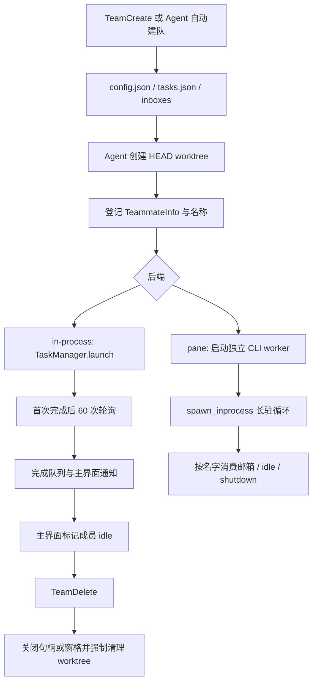

# 协作、记忆与 Worktree 源码分析

分析对象：`E:/AIAgentK开发/mewcode-python`。本文用于 StayCode 重写决策，只读取源码、测试与配置声明，没有执行原项目测试、模型请求、Git 变更、安装依赖或清理操作。源码中的系统提示词、内置 Agent Markdown 和工具描述均作为产品实现来分析，不作为本次工作的指令。

**核心结论：这些模块已具备完整的功能概念，但运行状态、身份、持久化和工作区回收尚未组成一致的闭环。** 普通子 Agent、后台任务、团队成员、共享任务板和会话是五种不同对象；重写时应先定义它们的关联与状态机，再移植界面和提示词。尤其不能直接保留团队删除时的强制 Worktree 回收行为。

文中“已证实”表示可以由当前静态调用链直接确认，不代表已经动态复现；“待验证”表示需要隔离测试、真实平台或运行时证据。

## 1. 模块覆盖与职责

以下文件均已审阅。`__init__.py` 主要做公开符号导出，无独立调度逻辑。

| 模块 | 文件 | 实际职责与关键边界 |
|---|---|---|
| Agent 定义 | `agents/parser.py`、`loader.py` | Markdown/YAML 定义解析；项目、用户、内置三层加载；文件热加载；插件源接口仍为 `pass` |
| 内置 Agent | `agents/builtins/explore.md`、`plan.md`、`general-purpose.md`、`verification.md`、`__init__.py` | Explore、Plan、通用执行、验证四类提示词；Verification 受加载开关控制 |
| 子 Agent 上下文与能力 | `agents/fork.py`、`tool_filter.py` | 深复制历史、补未完成工具结果、禁止再次 fork；普通、后台、队友、Coordinator 四类工具过滤 |
| 后台与观测 | `agents/task_manager.py`、`notification.py`、`trace.py`、`__init__.py` | asyncio 后台任务、完成队列、通知格式、内存 trace 节点与 token 汇总 |
| Agent 工具入口 | `tools/agent_tool.py` | 普通调用、fork、Worktree 子 Agent、team teammate 分流；模型选择；权限构造；后端启动 |
| 团队状态 | `teams/models.py`、`manager.py`、`registry.py` | 团队与成员 JSON、进程内缓存、名称解析、句柄和窗格回收 |
| 协作通信 | `teams/mailbox.py`、`protocol.py`、`shared_task.py` | 带锁邮箱、关闭/计划审批消息协议、共享任务板 |
| 后端运行 | `teams/backend_detect.py`、`spawn.py`、`spawn_inprocess.py`、`spawn_tmux.py`、`spawn_iterm2.py` | 自动后端选择、命令拼装、长驻循环、tmux 窗口、iTerm2 标签页 |
| 协作辅助 | `teams/coordinator.py`、`progress.py`、`transcript.py`、`__init__.py` | 调度提示词与稀疏提醒、实时进度、独立 transcript 序列化 |
| 团队工具 | `tools/team_create.py`、`team_delete.py`、`send_message.py` | 创建、删除、单播/广播与结构化消息 |
| 任务工具 | `tools/task_create.py`、`task_get.py`、`task_list.py`、`task_update.py`、`task_stop.py` | 前四者操作共享任务板；TaskStop 操作运行中的 teammate，二者不是同一任务系统 |
| Worktree | `worktree/models.py`、`slug.py`、`manager.py`、`changes.py`、`cleanup.py`、`setup.py`、`session.py`、`integration.py`、`__init__.py` | 创建、恢复、会话绑定、改动检测、过期清理、配置复制、路径提示 |
| 记忆 | `memory/instructions.py`、`session.py`、`auto_memory.py`、`recall.py`、`consolidation.py`、`__init__.py` | 指令文件、会话日志、长期记忆文件、按需召回、后台整理 |

补充读取了 `agent.py`、`app.py`、`__main__.py` 和权限检查器的相关入口，以区分“模块存在”与“产品入口真正调用”。

## 2. Subagent 与 teammate：概念相近，运行机制不同

| 维度 | 普通定义型 subagent | fork subagent | team teammate |
|---|---|---|---|
| 创建入口 | `Agent(subagent_type=...)` | 开启 fork 且省略类型 | `Agent(team_name=...)` 优先分流 |
| 上下文 | 新 `ConversationManager` | 深复制父历史并追加任务 | 指定类型时新上下文；开启 fork 且省略类型时尝试继承 |
| 工具 | 按定义及前后台规则过滤 | 复制父工具实例，仅浅复制 AgentTool 并标记禁止再 fork | 注入 TaskCreate/Get/List/Update、SendMessage；禁止管理团队和再派 Agent |
| 执行 | 默认同步；显式 background 或定义 background 时后台 | 强制后台 | 总是异步；in-process 与 pane 实现不一致 |
| 文件隔离 | 默认共享父工作目录；定义可选 worktree | 默认共享父工作目录 | 必须创建 HEAD 起点的独立 worktree |
| 结果 | 同步 ToolResult，或后台通知 | 后台通知 | 提示词要求 SendMessage；实际 in-process 最终还产生 task-notification |
| 后续任务 | 没有持久化续跑 API | 没有持久化续跑 API | 产品意图是长驻、可发消息续跑；当前实现并未在所有后端实现该契约 |
| 生命周期持久化 | 运行对象只在内存 | 同左 | 团队元数据落盘，运行句柄与对话续跑状态未统一持久化 |

证据：[入口分流与 fork](E:/AIAgentK开发/mewcode-python/mewcode/tools/agent_tool.py:123)、[背景执行](E:/AIAgentK开发/mewcode-python/mewcode/tools/agent_tool.py:203)、[工具过滤](E:/AIAgentK开发/mewcode-python/mewcode/agents/tool_filter.py:105)、[teammate 创建](E:/AIAgentK开发/mewcode-python/mewcode/tools/agent_tool.py:300)。工具描述中“没有 team_name 就阻塞”“team 总在自己的 terminal”只是过度简化，不能据此推断真实行为。

### 2.1 定义加载与权限

`AgentDef` 包含类型、适用描述、系统提示、工具白黑名单、模型、最大轮数、权限模式、后台标记与隔离模式。默认 200 轮。解析器校验 name/description 是否存在、maxTurns 是否为正整数、权限和 isolation 的枚举；模型允许任意非空路由名称的意图主要依赖下游，字段并未全面进行严格类型验证。[parser.py:30](E:/AIAgentK开发/mewcode-python/mewcode/agents/parser.py:30)、[parser.py:69](E:/AIAgentK开发/mewcode-python/mewcode/agents/parser.py:69)

加载优先级是项目 `.mewcode/agents` > 用户 `~/.mewcode/agents` > 内置；同名先到者获胜。`get()` 会重新读取已知文件，失败回退缓存；不会自动发现新文件。`register_plugin_source()` 尚未实现。内置加载构造 `AgentDef` 时未传 isolation，而外部文件解析会传。[loader.py:94](E:/AIAgentK开发/mewcode-python/mewcode/agents/loader.py:94)、[loader.py:120](E:/AIAgentK开发/mewcode-python/mewcode/agents/loader.py:120)、[loader.py:68](E:/AIAgentK开发/mewcode-python/mewcode/agents/loader.py:68)

Explore 禁止 EditFile/WriteFile，Plan 与 Verification 还禁止 NotebookEdit 等，但仍保留 Bash；“只读”很大程度来自提示词和通用权限模式，而非类型级只读执行器。普通子 Agent 的 `mcp__*` 工具在过滤前取出，最终无条件加回，因此定义里的工具白名单或黑名单不能限制这类工具。[tool_filter.py:112](E:/AIAgentK开发/mewcode-python/mewcode/agents/tool_filter.py:112)

in-process teammate 的注册表按固定白名单过滤，直接注册的 `mcp__*` 不在其中；白名单保留 ToolSearch/mcp_call。pane worker 又通过独立入口组装注册表。因此“所有后端具备完全相同能力”并不成立。[tool_filter.py:170](E:/AIAgentK开发/mewcode-python/mewcode/agents/tool_filter.py:170)、[__main__.py:592](E:/AIAgentK开发/mewcode-python/mewcode/__main__.py:592)

普通子 Agent 继承父规则引擎，但重新选择权限模式；fork 默认 BYPASS；teammate 无论定义的 permissionMode 是什么，实际都在 PLAN 与 BYPASS 二者中选择。[agent_tool.py:113](E:/AIAgentK开发/mewcode-python/mewcode/tools/agent_tool.py:113)、[agent_tool.py:189](E:/AIAgentK开发/mewcode-python/mewcode/tools/agent_tool.py:189)、[agent_tool.py:424](E:/AIAgentK开发/mewcode-python/mewcode/tools/agent_tool.py:424)

必须注意：创建 `PathSandbox(wt.path)` 不等于执行层强制隔离。检查器在 BYPASS 下不会因普通越界文件路径要求确认；非交互执行器遇到 ask 且为 BYPASS 时自动放行。受保护文件 deny、显式 deny 等仍有独立逻辑，不能概括成“没有任何权限限制”。这与 TEAMMATE_ADDENDUM 宣称原项目绝对路径必定被拒绝不一致。[checker.py:115](E:/AIAgentK开发/mewcode-python/mewcode/permissions/checker.py:115)、[agent.py:1347](E:/AIAgentK开发/mewcode-python/mewcode/agent.py:1347)、[agent_tool.py:67](E:/AIAgentK开发/mewcode-python/mewcode/tools/agent_tool.py:67)

### 2.2 Fork 与后台任务

fork 通过历史中的 `<fork_boilerplate>` 标记禁止嵌套，复制 env/ltm 已注入标记。末条 assistant 如有工具调用，会补 `interrupted` 结果以避免悬空调用。它只复制对话，不复制文件系统快照。[fork.py:29](E:/AIAgentK开发/mewcode-python/mewcode/agents/fork.py:29)

`TaskManager` 的 BackgroundTask ID 为 8 位随机十六进制，拥有 Agent 实例、任务文本、running/completed/failed/cancelled 字符串状态、结果、时间、取消函数和 token 进度；`asyncio.Task` 单独保存在另一字典。完成后把 ID 放进 Queue，`poll_completed()` 消费一次通知。所有这些都只在当前进程，重启不恢复。[task_manager.py:20](E:/AIAgentK开发/mewcode-python/mewcode/agents/task_manager.py:20)、[task_manager.py:51](E:/AIAgentK开发/mewcode-python/mewcode/agents/task_manager.py:51)、[task_manager.py:200](E:/AIAgentK开发/mewcode-python/mewcode/agents/task_manager.py:200)

`adopt_running()` 名称像是接管正在运行的过程，实际新建一个任务，再调用 `run_to_completion(bg.task)`，仅把旧 partial_result 拼接到结果；它没有接管原协程的控制权或原 conversation。[task_manager.py:139](E:/AIAgentK开发/mewcode-python/mewcode/agents/task_manager.py:139)

`TraceManager` 用另一个 12 位 ID 存父子关系、trace_id、tokens 和状态。前台 AgentTool 完成时更新 trace，后台 TaskManager 不调用 trace 更新。`notification.py` 会将结果截断为 5000 字符并作为 user-role 通知插入主对话；CLI 又有独立格式化代码，行为并不完全统一。[trace.py:12](E:/AIAgentK开发/mewcode-python/mewcode/agents/trace.py:12)、[agent_tool.py:291](E:/AIAgentK开发/mewcode-python/mewcode/tools/agent_tool.py:291)、[notification.py:18](E:/AIAgentK开发/mewcode-python/mewcode/agents/notification.py:18)、[__main__.py:276](E:/AIAgentK开发/mewcode-python/mewcode/__main__.py:276)

## 3. 团队生命周期、消息、任务和持久化

### 3.1 持久化关系

| 对象 | 存储位置 | 能恢复什么 | 不包含什么 |
|---|---|---|---|
| 团队与成员 | `~/.mewcode/teams/<slug>/config.json` | 名称、lead ID、成员 ID、model、worktreePath、backendType、isActive 等 | PID、运行租约、conversation ID、初始定义、实际权限快照 |
| 共享任务板 | 同目录 `tasks.json` | next_id 和 tasks | 自动调度、可恢复执行、状态迁移日志 |
| 邮箱 | `inboxes/<agent-key>.json` 与 `.json.lock` | 文本与结构化消息、已读状态 | 消费确认事务、重放游标、统一身份验证 |
| 团队 transcript | `transcripts/<agent_id>.json` | 显式调用保存的 conversation | 当前主运行链未调用 save/load，不能视为已有恢复能力 |
| BackgroundTask、Trace、句柄、pane ID | 内存 | 当前进程的查询与取消 | 重启恢复 |
| 主会话历史 | `<work_dir>/.mewcode/sessions/*.jsonl` 与 `.meta` | 对话和压缩边界 | 团队运行重建、worktree 操作事务 |

证据：[models.py:135](E:/AIAgentK开发/mewcode-python/mewcode/teams/models.py:135)、[manager.py:36](E:/AIAgentK开发/mewcode-python/mewcode/teams/manager.py:36)、[transcript.py:72](E:/AIAgentK开发/mewcode-python/mewcode/teams/transcript.py:72)、[session.py:400](E:/AIAgentK开发/mewcode-python/mewcode/memory/session.py:400)。全项目符号检索未发现生产代码调用 `save_transcript/load_transcript`；测试证明序列化本身存在，不能证明团队恢复已经接入。

### 3.2 创建、续跑、停止、删除

`create_team()` 先清洗团队名并避重，再写 config、空任务板和 inboxes。`get_team()` 首次从磁盘读取后长期缓存；`list_teams()` 只返回缓存里的团队，不扫描用户目录。名称注册表是进程全局的 `name -> agent_id`，没有 team 命名空间；同名跨团队会覆盖。[manager.py:58](E:/AIAgentK开发/mewcode-python/mewcode/teams/manager.py:58)、[manager.py:95](E:/AIAgentK开发/mewcode-python/mewcode/teams/manager.py:95)、[registry.py:33](E:/AIAgentK开发/mewcode-python/mewcode/teams/registry.py:33)

teammate 创建顺序是：必要时自动创建团队 → 选择名称/定义 → 创建 worktree → 选择模型 → 生成 trace ID → 构造工具与权限 → 登记成员 → 启动执行。中途失败没有统一回滚。pane 启动异常处日志说“falling back”，实际只是返回错误，已登记成员、trace、worktree 和初始邮箱消息可能保留。[agent_tool.py:321](E:/AIAgentK开发/mewcode-python/mewcode/tools/agent_tool.py:321)、[agent_tool.py:375](E:/AIAgentK开发/mewcode-python/mewcode/tools/agent_tool.py:375)、[agent_tool.py:530](E:/AIAgentK开发/mewcode-python/mewcode/tools/agent_tool.py:530)

**in-process 当前不是长驻 teammate 循环。** AgentTool 调用 `TaskManager.launch()`；首轮完成立即将任务状态设为 completed，然后最多执行 60 次“一秒等待+收消息”。每次跟进调用 `run_to_completion(prompt)` 都未传入旧 ConversationManager，而该方法无 conversation 时会创建新历史。因此跟进不保留先前对话，且超出轮询窗口后无法再次唤醒。最终结果通知在轮询结束才入 Queue。[agent_tool.py:469](E:/AIAgentK开发/mewcode-python/mewcode/tools/agent_tool.py:469)、[task_manager.py:83](E:/AIAgentK开发/mewcode-python/mewcode/agents/task_manager.py:83)、[agent.py:1151](E:/AIAgentK开发/mewcode-python/mewcode/agent.py:1151)

真正的长驻循环位于 `spawn_inprocess_teammate()`，它复用同一个 conv，首轮后发 idle、无限等待消息或 shutdown，并支持计划审批；但生产调用者是独立 pane worker 入口。名字叫 inprocess 并不代表 AgentTool 的 in-process 分支使用它。[spawn_inprocess.py:213](E:/AIAgentK开发/mewcode-python/mewcode/teams/spawn_inprocess.py:213)、[__main__.py:627](E:/AIAgentK开发/mewcode-python/mewcode/__main__.py:627)

`TaskStop` 通过 `TeamManager.stop_member()` 查 `_inprocess_handles` 或 `_pane_ids`。AgentTool 的 in-process 路径未调用 `register_inprocess_handle()`，所以实际派出的 in-process teammate 与停止接口脱节。测试用手工注册 MagicMock handle 证明了 manager 的局部行为，并未覆盖真实启动链。[task_stop.py:45](E:/AIAgentK开发/mewcode-python/mewcode/tools/task_stop.py:45)、[manager.py:169](E:/AIAgentK开发/mewcode-python/mewcode/teams/manager.py:169)、[test_teams.py:683](E:/AIAgentK开发/mewcode-python/tests/test_teams.py:683)

成员 isActive 与任务完成状态不是同一个状态源。TUI 消费最终 BackgroundTask 通知后才调用 `on_teammate_completed()` 标 idle；pane 的 idle 文本被普通消费，并没有同样的结构化成员更新路径。`stop_member()` 改内存状态但不 save。`delete_team()` 仅要求成员 `is_active is False`，随后清理工作区和整个团队目录；不会核对工作成果是否合并。[app.py:1602](E:/AIAgentK开发/mewcode-python/mewcode/app.py:1602)、[manager.py:199](E:/AIAgentK开发/mewcode-python/mewcode/teams/manager.py:199)、[manager.py:206](E:/AIAgentK开发/mewcode-python/mewcode/teams/manager.py:206)

### 3.3 邮箱与协议

每个收件箱是一个 JSON 数组；同实例 threading.Lock 结合 O_EXCL 锁文件避免读改写竞争。抢锁最长 5 秒；锁文件年龄超过 10 秒认为失效；consume 把未读标为已读，不删除消息。已读历史会持续增长。磁盘 JSON 仍是直接覆盖写，未使用临时文件原子替换；损坏 JSON 被读成空列表，后续写会丢弃原内容。[mailbox.py:90](E:/AIAgentK开发/mewcode-python/mewcode/teams/mailbox.py:90)、[mailbox.py:133](E:/AIAgentK开发/mewcode-python/mewcode/teams/mailbox.py:133)、[mailbox.py:169](E:/AIAgentK开发/mewcode-python/mewcode/teams/mailbox.py:169)

协议包括 text、shutdown_request/response、plan_approval_request/response，使用随机 request_id 和 approve 布尔值；关闭请求兼容 `[shutdown]` 前缀。数据结构本身合理，但路由和消费经常把它降格为文本：lead 的 drain 只保留 `from=text`；Agent 消费保留 type 文字，却不提供 request_id/approve；TaskManager 跟进只保留 from/text。计划审批所需关联 ID 无法通过这些通知完整传到调度者。[protocol.py:19](E:/AIAgentK开发/mewcode-python/mewcode/teams/protocol.py:19)、[manager.py:259](E:/AIAgentK开发/mewcode-python/mewcode/teams/manager.py:259)、[agent.py:893](E:/AIAgentK开发/mewcode-python/mewcode/agent.py:893)

消息身份有明确接线问题：

1. pane 初始任务写入 **成员名字** 的收件箱；worker 也按名字轮询，但 lead 的 SendMessage 解析成 **随机 agent_id** 后写入另一个收件箱。初始派工可能成功，后续消息却投错位置。[agent_tool.py:496](E:/AIAgentK开发/mewcode-python/mewcode/tools/agent_tool.py:496)、[send_message.py:144](E:/AIAgentK开发/mewcode-python/mewcode/tools/send_message.py:144)、[spawn_inprocess.py:68](E:/AIAgentK开发/mewcode-python/mewcode/teams/spawn_inprocess.py:68)
2. 独立 worker 只注册自己与 lead，未注册团队其他成员；lead/in-process 路径只注册 teammate，没有对应的 lead 名称注册。因此“队友任意互发”“给 lead 发消息”的可用性取决于后端，不能由提示词保证。[__main__.py:587](E:/AIAgentK开发/mewcode-python/mewcode/__main__.py:587)、[manager.py:128](E:/AIAgentK开发/mewcode-python/mewcode/teams/manager.py:128)
3. lead 的 SendMessage 未绑定团队时永远选 `list_teams()[0]`；再由全局注册表解析收件人，可能把第二个团队的成员 ID 写进第一个团队目录。[send_message.py:58](E:/AIAgentK开发/mewcode-python/mewcode/tools/send_message.py:58)
4. `_run_plan_approval()` 调 consume 后只处理匹配审批，其余消息已被标读，并没有注释所说的“留到下一轮”；shutdown 也可能丢失。[spawn_inprocess.py:123](E:/AIAgentK开发/mewcode-python/mewcode/teams/spawn_inprocess.py:123)

计划审批还有运行入口差异：AgentTool 的 in-process 路径根本不走审批循环；pane worker 自行加载第一个 provider、BYPASS 和项目指令，未从 TeammateInfo 恢复父侧的 model、定义、plan_mode_required、fork conversation。因此需要整体重做审批状态机，而不是仅修消息字段。[__main__.py:570](E:/AIAgentK开发/mewcode-python/mewcode/__main__.py:570)、[__main__.py:603](E:/AIAgentK开发/mewcode-python/mewcode/__main__.py:603)

### 3.4 共享任务板不是调度器

SharedTask 包含 id、title、description、status、assignee、blocks、blocked_by、created_by。TaskCreate/Get/List/Update 是轻量 CRUD；TaskUpdate 在工具层验证四种状态，底层 store 不验证。依赖是两个独立列表，没有双向同步、环检测、引用存在性检查、认领原子性或依赖满足后的自动启动。[shared_task.py:13](E:/AIAgentK开发/mewcode-python/mewcode/teams/shared_task.py:13)、[task_update.py:45](E:/AIAgentK开发/mewcode-python/mewcode/tools/task_update.py:45)

store 在初始化读取文件，create 不再刷新，update/get/list 才重新读取；所有修改直接覆盖整个 JSON，没有锁和版本检查。两个 worker 即便顺序创建，也可能各自拿过期 next_id 覆盖彼此。`_load()` 也不先清空字典。不能把该存储视为可靠的跨进程任务数据库。[shared_task.py:36](E:/AIAgentK开发/mewcode-python/mewcode/teams/shared_task.py:36)、[shared_task.py:59](E:/AIAgentK开发/mewcode-python/mewcode/teams/shared_task.py:59)

Coordinator 的工具仅 Agent、SendMessage、TaskStop、SyntheticOutput、TeamDelete；提示词每 5 轮恢复全文，中间给短提醒。实际模式由启动配置决定，创建/删除团队不会切换。`tool_filter.py` 中仍有“TeamDelete 用来解除 coordinator”旧注释，应以执行代码和多团队回归测试为准。[coordinator.py:198](E:/AIAgentK开发/mewcode-python/mewcode/teams/coordinator.py:198)、[team_create.py:101](E:/AIAgentK开发/mewcode-python/mewcode/tools/team_create.py:101)、[team_delete.py:50](E:/AIAgentK开发/mewcode-python/mewcode/tools/team_delete.py:50)

## 4. Worktree 生命周期、成果合并和清理

### 4.1 创建与初始化

WorktreeManager 默认把 worktree 放到 `<repo>/.mewcode/worktrees`。slug 最长 64 字符，允许 `/` 分层，拒绝 `.`、`..` 段；磁盘名把 `/` 替换为 `+`，分支名是 `worktree-<flat>`。创建使用 `git worktree add -B <branch> <path> <base>`，base 默认 HEAD，不包含父工作目录未提交改动。[slug.py:14](E:/AIAgentK开发/mewcode-python/mewcode/worktree/slug.py:14)、[manager.py:118](E:/AIAgentK开发/mewcode-python/mewcode/worktree/manager.py:118)

如目标目录 `.git` 指向的 HEAD 能读取，则快速复用，读取 loose refs、commondir、packed-refs；不会核对实际分支与请求 base。此时 head_commit 被赋值为当前 HEAD，丢失原始创建基线的语义。`-B` 在分支已存在且允许重置时也可能覆盖旧 branch 引用，需要重写时明确禁止隐式重置已有成果。[manager.py:69](E:/AIAgentK开发/mewcode-python/mewcode/worktree/manager.py:69)、[manager.py:131](E:/AIAgentK开发/mewcode-python/mewcode/worktree/manager.py:131)

创建后四项 setup：复制根目录 `settings.local.json` 和 `.env`；设置 hooksPath；对配置目录建 symlink；按 `.worktreeinclude` 复制 ignored 文件。目录模式即使匹配，末端只处理 `src.is_file()`，因此不能据注释推断整个目录会被递归复制。hooksPath 使用普通 `git config`，没有 worktree-local scope；应验证共享仓库配置受影响的范围。[setup.py:22](E:/AIAgentK开发/mewcode-python/mewcode/worktree/setup.py:22)、[setup.py:62](E:/AIAgentK开发/mewcode-python/mewcode/worktree/setup.py:62)、[setup.py:123](E:/AIAgentK开发/mewcode-python/mewcode/worktree/setup.py:123)

`enter()` 只记录 original_cwd、branch、HEAD 和 worktree 信息，并写 `.mewcode/worktree_session.json`；manager 自身没有 os.chdir。`restore_session()` 只恢复该单一 session，不枚举 Git 中全部 worktree，且再一次以当前 HEAD 填充 Worktree.head_commit。[manager.py:176](E:/AIAgentK开发/mewcode-python/mewcode/worktree/manager.py:176)、[manager.py:274](E:/AIAgentK开发/mewcode-python/mewcode/worktree/manager.py:274)、[session.py:23](E:/AIAgentK开发/mewcode-python/mewcode/worktree/session.py:23)

### 4.2 正常退出与自动回收

普通 exit 支持 keep/remove。remove 且未明确 discard_changes 时，依据 `git status --porcelain` 和 `git rev-list <head_commit>..HEAD` 检查未提交/新提交；有变化即拒绝。auto_cleanup 在没有变化时 remove，否则返回保留路径和分支。[manager.py:201](E:/AIAgentK开发/mewcode-python/mewcode/worktree/manager.py:201)、[changes.py:35](E:/AIAgentK开发/mewcode-python/mewcode/worktree/changes.py:35)、[manager.py:248](E:/AIAgentK开发/mewcode-python/mewcode/worktree/manager.py:248)

普通隔离 subagent 成功后调用 auto_cleanup，有变化则在结果中附保留地址；执行异常分支提前返回，没有 finally 清理或状态登记。参数 schema 虽有 `isolation`，execute 实际只从 AgentDef 读取隔离模式，`p.isolation` 未参与分流；显式参数无法触发。worktree 执行分支始终前台，也忽略了 background 选择。[agent_tool.py:129](E:/AIAgentK开发/mewcode-python/mewcode/tools/agent_tool.py:129)、[agent_tool.py:665](E:/AIAgentK开发/mewcode-python/mewcode/tools/agent_tool.py:665)

过期清理只扫描匹配临时命名模式的目录；排除当前会话，检查目录 mtime、变化和未推送提交后删除。team worktree 的 `team-...+...` 不在临时模式中。检查未推送提交是较好的保护，但后台仍没有运行中的 worker 租约表，只排除一个 current_session。[cleanup.py:21](E:/AIAgentK开发/mewcode-python/mewcode/worktree/cleanup.py:21)、[cleanup.py:34](E:/AIAgentK开发/mewcode-python/mewcode/worktree/cleanup.py:34)

### 4.3 合并和删除之间存在缺口

**worktree 包没有实现 merge/cherry-pick/冲突处理事务。** Coordinator 提示词让 worker 执行 Git 合并，这是一种模型工作流，不是 WorktreeManager 的能力。重写规划必须把“完成计算”“成果已保存”“成果已集成”“允许回收”分成不同状态。[coordinator.py:72](E:/AIAgentK开发/mewcode-python/mewcode/teams/coordinator.py:72)

现有三种清理路径的保护强度不同：

| 清理路径 | 保护 | 明确缺口 |
|---|---|---|
| `exit(remove)` / `auto_cleanup` | 检查本地变更与基线后的提交 | Git 非零退出码没有转换为 unknown/保留，可能被当成 0 变更 |
| stale cleanup | 额外检查未推送提交、年龄与命名模式 | 未检查运行租约；删除失败也可能计入 removed |
| TeamDelete | 只要求成员 idle | `_cleanup_worktree` 直接 `git worktree remove --force`，不检查改动，不调用 manager 的保护逻辑 |

尤其 TeamDelete 可能丢弃未提交文件；分支通常仍保留，但不能挽救未提交文件。该 Git 调用未指定仓库 cwd、未检查 returncode；只有抛异常时才进入 `shutil.rmtree()` 后备逻辑。正常 Git 失败可静默残留，异常后备又缺少路径归属核验。[manager.py:310](E:/AIAgentK开发/mewcode-python/mewcode/teams/manager.py:310)

WorktreeManager._remove_worktree 也会在 `git worktree remove` 非零后继续尝试 branch -D，并从 active 删除记录；操作结果与内存状态不具有事务一致性。[manager.py:230](E:/AIAgentK开发/mewcode-python/mewcode/worktree/manager.py:230)

## 5. 记忆的三种层级与实际数据流

这里应区分两个概念：按用途可分为 **指令记忆、会话记忆、长期自动记忆** 三层；长期自动记忆的存储 scope 则只有 **用户级、项目级** 两种，并不存在第三个全局自动记忆目录。

| 层级 | 内容和生命周期 | 文件或入口 |
|---|---|---|
| 指令层 | 人工维护、每次启动发现、为后续行为提供上下文 | 用户 MEWCODE.md/AGENTS.md；Git 根到 cwd 目录链；cwd/MEWCODE.local.md |
| 会话层 | 原始消息、工具调用/结果、压缩边界，可恢复对话 | `<work_dir>/.mewcode/sessions/<id>.jsonl` 和 `.meta` |
| 长期层 | 从多轮/多会话提取和维护的稳定信息，独立 Markdown 文件 | 用户与项目 `.mewcode/memory/`，各自 MEMORY.md 索引 |

### 5.1 指令文件

发现顺序是用户全局 → 项目祖先目录从外到内 → cwd 的 local 文件。读取后按顺序串接，所谓“优先级”主要依赖模型理解，并非规则冲突解析器。支持独立一行 `@./`、`@../`、`@~/`、`@/` include，跳过反引号围栏、有 seen 去环及深度限制。[instructions.py:159](E:/AIAgentK开发/mewcode-python/mewcode/memory/instructions.py:159)、[instructions.py:52](E:/AIAgentK开发/mewcode-python/mewcode/memory/instructions.py:52)

`project_root` 参数没有用于 include 路径限制，允许把工作区外可读文件展开进上下文。它可能是有意提供的功能，但必须有明确来源与信任边界。Windows 的 `@C:/...`、反斜杠路径和含空格路径不被当前语法识别。[instructions.py:22](E:/AIAgentK开发/mewcode-python/mewcode/memory/instructions.py:22)

### 5.2 会话存储与恢复

每条 Message 生成一条 JSONL，工具 use/result 内联保存，思考签名不落盘。写入后 flush，单独更新 meta；这不是 fsync，也不是两文件事务。标题取首个用户消息前 50 字符；时间使用 UTC，session ID 用本地时间加短随机串。[session.py:115](E:/AIAgentK开发/mewcode-python/mewcode/memory/session.py:115)、[session.py:307](E:/AIAgentK开发/mewcode-python/mewcode/memory/session.py:307)、[session.py:394](E:/AIAgentK开发/mewcode-python/mewcode/memory/session.py:394)

压缩记录 `compact_boundary` 内联 summary 和 keep 尾部（包含工具块），旧消息仍在磁盘审计。resume 从最后一个边界开始重放；没有边界则完整重放；悬空工具调用留给发送前的 pairing 修复。这是值得保留的设计，避免恢复后再次加载已经压缩掉的大量历史。[session.py:168](E:/AIAgentK开发/mewcode-python/mewcode/memory/session.py:168)、[session.py:430](E:/AIAgentK开发/mewcode-python/mewcode/memory/session.py:430)

已知限制：损坏 JSONL 行可跳过，但 `.meta` 缺失或损坏会导致整个 resume 不可用；边界 payload 容错有限，部分结构类型未严格校验；resume 先把整个 JSONL 读入内存再找最后边界。没有 schemaVersion、校验和、写入者租约，多个会话句柄可同时追加同一个文件。默认 cleanup 依据 meta 的 last_active 清理 30 天旧会话。summary 使用最近 10 条消息再发模型调用，不是确定性摘要。[session.py:273](E:/AIAgentK开发/mewcode-python/mewcode/memory/session.py:273)、[session.py:357](E:/AIAgentK开发/mewcode-python/mewcode/memory/session.py:357)、[session.py:491](E:/AIAgentK开发/mewcode-python/mewcode/memory/session.py:491)

### 5.3 长期自动记忆

用户级 `~/.mewcode/memory` 存 user/feedback，项目级 `<project>/.mewcode/memory` 存 project/reference；项目路径可以被 `MEWCODE_REMOTE_MEMORY_DIR` 覆盖。每个目录 MEMORY.md 是索引，每条正文为独立 `.md`。MemoryManager.load 会创建目录并把两份索引加入记忆提示；索引单份限制 200 行、25KB，UTF-8 截断避免切坏字符。[auto_memory.py:48](E:/AIAgentK开发/mewcode-python/mewcode/memory/auto_memory.py:48)、[auto_memory.py:156](E:/AIAgentK开发/mewcode-python/mewcode/memory/auto_memory.py:156)、[auto_memory.py:352](E:/AIAgentK开发/mewcode-python/mewcode/memory/auto_memory.py:352)

MemoryManager 提供列表、显示、清理，同时有裸模型调用的 `extract()`：按上次 extraction 的历史长度截取新消息 → 生成已有记忆 manifest → 请求 MEMORY_NAME/TYPE/DESC/BODY 文本 → 解析并直接写文件与索引。主 Agent 的 MEMORY_EXTRACTION_INTERVAL=1，纯文本结束时异步提取；Agent 内有 `_extracting/_pending_extraction` 合并重叠请求，但不提供跨进程写锁。[auto_memory.py:410](E:/AIAgentK开发/mewcode-python/mewcode/memory/auto_memory.py:410)、[agent.py:57](E:/AIAgentK开发/mewcode-python/mewcode/agent.py:57)、[agent.py:1083](E:/AIAgentK开发/mewcode-python/mewcode/agent.py:1083)

提取链路中的静态缺陷：

- **模型输出直接决定文件路径。** MEMORY_NAME 不校验为安全文件名，`Path(target_dir) / f"{name}.md"` 后直接 write_text，没有 resolve 后目录归属检查，也不经过工具权限层。带路径分隔符、上级目录或绝对路径的名称可能逃出记忆目录；未在本次触发该行为。[auto_memory.py:484](E:/AIAgentK开发/mewcode-python/mewcode/memory/auto_memory.py:484)
- `_extract_field()` 只取当前行，MEMORY_BODY 多行会丢失后续正文；输出按 `---` 切块也容易与正文冲突。[auto_memory.py:574](E:/AIAgentK开发/mewcode-python/mewcode/memory/auto_memory.py:574)
- 索引已有同名文件时只跳过新增，不同步更新已有描述；内容文件与索引并非原子提交。[auto_memory.py:508](E:/AIAgentK开发/mewcode-python/mewcode/memory/auto_memory.py:508)
- 提取等待模型期间会话可能继续增长，但完成后 cursor 直接取当时的 `len(history)`，可能把本次 prompt 未包含的新消息也标成已提取；压缩缩短历史还会使基于长度的 cursor 失去语义。[auto_memory.py:422](E:/AIAgentK开发/mewcode-python/mewcode/memory/auto_memory.py:422)、[auto_memory.py:478](E:/AIAgentK开发/mewcode-python/mewcode/memory/auto_memory.py:478)
- 写入格式使用 `metadata.type` 嵌套，提示示例要求顶层 type；当前手工解析器忽略缩进，恰好仍能识别，但换成标准 YAML schema 后需要迁移兼容。[auto_memory.py:281](E:/AIAgentK开发/mewcode-python/mewcode/memory/auto_memory.py:281)、[auto_memory.py:501](E:/AIAgentK开发/mewcode-python/mewcode/memory/auto_memory.py:501)

### 5.4 记忆召回

recall 递归扫描每个 scope 的 `.md`，排除 MEMORY.md；只读前 30 行元数据，按 mtime 新到旧保留每目录最多 200 个。过滤已注入路径后发辅助模型选择，理想上最多 5 条；TUI 设置 8 秒超时，并与主调用并行。结果在主 Agent **工具执行后** 才注入；没有工具的一轮不会消费，相关测试明确验证了这一行为。[recall.py:164](E:/AIAgentK开发/mewcode-python/mewcode/memory/recall.py:164)、[app.py:1275](E:/AIAgentK开发/mewcode-python/mewcode/app.py:1275)、[agent.py:866](E:/AIAgentK开发/mewcode-python/mewcode/agent.py:866)

召回结果包含正文与路径；只有真正注入才更新 surfaced set，避免空结果永久屏蔽记忆。两天以上的记忆附“需重新核实”提示。但路径 set 不带版本，文件更新后同一路径仍被排除；render 整个正文，没有长度/token 上限。[recall.py:71](E:/AIAgentK开发/mewcode-python/mewcode/memory/recall.py:71)、[recall.py:109](E:/AIAgentK开发/mewcode-python/mewcode/memory/recall.py:109)、[recall.py:355](E:/AIAgentK开发/mewcode-python/mewcode/memory/recall.py:355)

召回存在确定的契约不一致：manifest 提供绝对 file_path，但 `_select_relevant_memories()` 只接受 filename 集合，因此模型照抄 manifest 中的绝对路径会被丢弃；后续 by_key 虽支持绝对路径也无法补救前面的过滤。用户/项目存在同名 filename 时默认映射用户级；“最多 5 个”只在提示词中，返回值没有代码上限或去重。[recall.py:244](E:/AIAgentK开发/mewcode-python/mewcode/memory/recall.py:244)、[recall.py:285](E:/AIAgentK开发/mewcode-python/mewcode/memory/recall.py:285)、[recall.py:306](E:/AIAgentK开发/mewcode-python/mewcode/memory/recall.py:306)

### 5.5 后台整理（autoDream）

MemoryConsolidator 默认 24 小时时间门、5 个最近会话门、10 分钟扫描节流。通过项目记忆目录的 `.consolidate-lock` mtime 记录整理时间，PID 判断活跃持有者；1 小时后视为陈旧。触发后创建独立 Agent、15 轮、Read/Write/Edit/Glob/Grep/Bash 工具，对项目和用户记忆做合并、纠错、删旧和索引维护。实际创建新 conversation，并非继承父历史的 fork。[consolidation.py:27](E:/AIAgentK开发/mewcode-python/mewcode/memory/consolidation.py:27)、[consolidation.py:51](E:/AIAgentK开发/mewcode-python/mewcode/memory/consolidation.py:51)、[consolidation.py:139](E:/AIAgentK开发/mewcode-python/mewcode/memory/consolidation.py:139)

锁采用先读取、再 write_text、再回读 PID，不是 O_EXCL/数据库事务，两个进程可在不同瞬间各自读回自己的 PID 并同时进入；只在项目目录锁定，却可能同时写跨项目共享的用户记忆。成功后保持锁文件 mtime 作为冷却时间，失败回滚 mtime；后台任务不登记在 TaskManager，主进程退出或取消时没有统一回收。[consolidation.py:194](E:/AIAgentK开发/mewcode-python/mewcode/memory/consolidation.py:194)、[consolidation.py:90](E:/AIAgentK开发/mewcode-python/mewcode/memory/consolidation.py:90)

整理器直接拼 `<work_dir>/.mewcode/memory`，不读取 MEWCODE_REMOTE_MEMORY_DIR；因此可能与 MemoryManager 操作不同记忆库。提示词说 Bash 只读且写操作会被拒绝，但注册的是普通 Bash，checker 为 BYPASS、sandbox 根为项目目录加用户记忆目录；没有专属只读 Bash enforcement。[consolidation.py:45](E:/AIAgentK开发/mewcode-python/mewcode/memory/consolidation.py:45)、[consolidation.py:147](E:/AIAgentK开发/mewcode-python/mewcode/memory/consolidation.py:147)、[consolidation.py:339](E:/AIAgentK开发/mewcode-python/mewcode/memory/consolidation.py:339)

## 6. 跨平台与执行边界

| 领域 | 当前实现 | StayCode 必须明确的契约 |
|---|---|---|
| 后端选择 | Windows 强制 in-process；非交互同样；POSIX 根据 TMUX/ITERM_SESSION_ID | Windows 先稳定 in-process，再独立支持原生进程/PTY；不能把 pane 能力当通用能力 |
| Shell | pane 命令是 POSIX `cd ... && python -m mewcode` | 使用 argv/专属 launcher；不要跨 shell 重用转义 |
| 转义 | shell_quote 只对空白、引号、反斜杠、美元、反引号触发引号 | `; & | < > ( )` 等仍可能被 shell 解释；路径和名字需要完整安全转义 |
| Worktree 名 | slug 允许 ASCII 字符、点和连字符 | Windows 设备名、大小写碰撞、尾点、长路径；同时验证 Git 分支名规则 |
| symlink | os.symlink 失败仅 warning | Windows 权限、Developer Mode、junction/copy 策略；共享依赖目录不代表写隔离 |
| 编码 | 文件明确 UTF-8，Git subprocess 多处 text=True 无 encoding | 中文路径、Git quoted paths、系统 code page；用 `-z` 输出和明确解码策略 |
| PID 检测 | Windows OpenProcess；POSIX kill(pid,0) | AccessDenied 与“不存活”区分、PID 重用、持有者 token/heartbeat |
| 路径匹配 | memory 使用字符串 startswith；include 主要 POSIX 形式 | 规范化、大小写、symlink、UNC/盘符、实际目录包含关系 |
| 并发阻塞 | async 方法内同步 subprocess.run；邮箱用 time.sleep 抢锁 | worker thread/async subprocess；单次 Git 可阻塞事件循环 30–60 秒 |

证据：[backend_detect.py:31](E:/AIAgentK开发/mewcode-python/mewcode/teams/backend_detect.py:31)、[spawn.py:11](E:/AIAgentK开发/mewcode-python/mewcode/teams/spawn.py:11)、[setup.py:74](E:/AIAgentK开发/mewcode-python/mewcode/worktree/setup.py:74)、[manager.py:52](E:/AIAgentK开发/mewcode-python/mewcode/worktree/manager.py:52)、[consolidation.py:239](E:/AIAgentK开发/mewcode-python/mewcode/memory/consolidation.py:239)、[auto_memory.py:76](E:/AIAgentK开发/mewcode-python/mewcode/memory/auto_memory.py:76)。

## 7. 证实风险与待验证项目

### 7.1 由源码确认的高优先级风险

| 优先级 | 问题 | 直接影响 | 首要修复方向 |
|---|---|---|---|
| P0 | TeamDelete 绕过改动检查 force remove | 未提交成果可能删除 | 统一 WorkspaceLease/ChangeSet 检查和保留策略 |
| P0 | 自动记忆名直接拼路径写盘 | 模型输出可超出记忆目录 | 结构化 schema、安全 ID、受控存储服务 |
| P1 | in-process spawn 与 TaskStop 句柄不相连 | 报告“没在运行”但 worker 仍执行 | 统一 RunHandle 注册和取消接口 |
| P1 | in-process 后续任务新建 conversation，且轮询有限 | 不能实现宣传的持续有上下文 teammate | 所有后端运行相同 session state machine |
| P1 | name/agent_id、team/global registry 混用 | pane 续跑、跨成员、跨团队消息路由错误 | 以 `(team_id, member_id)` 唯一寻址 |
| P1 | 协议字段在通知边界丢失、审批循环未统一接入 | 审批/关闭无法可靠匹配与执行 | 类型化事件与持久化请求状态 |
| P1 | SharedTaskStore 无锁覆盖 JSON | 任务丢失、ID 冲突、状态覆盖 | SQLite 事务、乐观版本或单写入服务 |
| P1 | worktree 变化检测非零退出被当零；恢复改变基线 | 清理决策失去可信证据 | clean/dirty/unknown 三态，固定基线 |
| P1 | 工具只读/Worktree 隔离依赖提示词，BYPASS 放宽路径与 ask | 声明能力与执行边界不一致 | 能力约束不可被调用方模式放宽 |
| P1 | recall absolute/relative path 契约冲突 | 已选记忆静默丢失或同名误选 | opaque memory ID，与路径完全分离 |
| P2 | 创建失败缺回滚，删除失败仍移除内存状态 | 孤儿 worktree、悬挂成员、难恢复 | 补偿事务与可重试状态 |
| P2 | 整理锁非原子、跨项目共享记忆无统一锁 | 并发整理与覆盖 | 用户/项目存储事务或锁租约 |
| P2 | 会话/邮箱非原子元数据写、恢复依赖 meta | 崩溃后损坏或无法恢复 | append event + 原子快照 + 重建索引 |
| P2 | fork/后台 trace、进度、会话恢复断开 | UI 状态、token、真实执行不一致 | 执行事件驱动的投影 |

### 7.2 尚未动态验证的事项

- 真实 Windows、Linux tmux、macOS iTerm2 的创建、消息往返、关闭、进程重启后恢复；本次没有启动任何 worker。
- `.git` packed refs、linked worktree、reftable 等不同仓库布局的恢复兼容；当前代码手读 Git 内部文件，需实际版本矩阵。
- Git 命令失败、目录被占用、没有权限、中文/空格路径、已有分支/dirty worktree 下的清理副作用；本次未运行删除路径。
- 多进程邮箱写、进程被杀在写入中途、锁持有超 10 秒、任务板同时认领、不同项目同时整理用户记忆的复现概率与恢复结果。
- 模型输出恶意/异常 MEMORY_NAME、多行正文、坏 JSON、超大召回、记忆文件 symlink 等边界；现有缺少边界校验已确认，实际运行应仅在临时目录验证。
- 权限 checker、shell 执行器与操作系统沙箱的完整联合效果，需要与执行安全模块报告一起评估；不能仅凭本报告判断所有外部命令是否可逃逸。

## 8. 测试覆盖与证据强度

本专题作者**未另行运行测试**，下表只说明已读取的测试断言及其边界。根代理执行的 33 项聚焦测试包含 `test_team_protocol.py`，完整基线见 [交互与验证报告](04-interface-and-validation.md)。特别是 `test_consolidation.py` 包含受环境变量控制的真实模型测试，不应未经区分直接运行整个文件。

| 测试文件 | 已覆盖的设计 | 仍缺少的关键覆盖 |
|---|---|---|
| `tests/test_subagent.py` | parser/loader 优先级、热加载、过滤、fork 深复制与悬空工具补齐、trace、TaskManager 成功/失败/取消、通知、规则引擎继承 | AgentTool 真实多分支启动到完成；MCP 限制；background trace；显式 isolation；真实 worktree 工具路径 |
| `tests/verify_subagent.py` | 无 LLM 的手工组件校验脚本 | 依赖项目自定义 Agent/配置；有与当前全局过滤相矛盾的 EnterPlanMode 断言，不能作为无条件端到端验收 |
| `tests/test_teams.py` | 模型序列化、顺序任务 CRUD、邮箱线程写、后端判断、Coordinator 工具、transcript roundtrip、手工句柄停止、idle 投给 lead | 实际 spawn→send→continue→stop→delete；跨进程、多 team、身份一致性、审批状态、成果保留 |
| `tests/test_team_protocol.py` | 消息构造、request_id 唯一性、approve 序列化 | 协议从 mailbox 经 drain 到模型再回复的全链路 |
| `tests/test_teammate_registry.py` | 独立 worker 协作工具存在、管理工具缺席 | 模型、权限、AgentDef、MCP 在各后端的等价性 |
| `tests/test_coordinator_multi_team.py` | 建/删多个团队不改变由配置确定的工具集；pytest 的 autouse fixture 把团队目录重定向临时目录 | 多团队 SendMessage 路由；不能把工具集稳定性测试视为多团队通信测试 |
| `tests/test_worktree.py` | slug/session、临时 Git 仓库创建/复用、enter/exit、dirty 保留、清洁自动删除 | TeamDelete 的另一清理入口、Git 错误返回、恢复后原始基线、崩溃回滚、合并、安全保留 |
| `tests/test_memory.py` | include、指令层级、会话内联工具块、JSONL、resume、compact boundary、MemoryManager 与 LTM 注入 | 提取文件名安全、多行正文、cursor 压缩/并发、召回 ID 契约、存储事务 |
| `tests/test_memory_recall_wiring.py` | 工具执行后注入；无工具不记 surfaced | 真正 scan/selector/路径过滤/render 上限 |
| `tests/test_consolidation.py` | 锁基本行为、子 Agent 组装、规则继承、用户 memory 路径；可选真实 LLM 整理 | 原子锁竞争、跨项目用户记忆、MEWCODE_REMOTE_MEMORY_DIR、提示词只读与执行约束一致性 |

证据入口：[test_subagent.py:367](E:/AIAgentK开发/mewcode-python/tests/test_subagent.py:367)、[test_teams.py:308](E:/AIAgentK开发/mewcode-python/tests/test_teams.py:308)、[test_teams.py:683](E:/AIAgentK开发/mewcode-python/tests/test_teams.py:683)、[test_team_protocol.py:44](E:/AIAgentK开发/mewcode-python/tests/test_team_protocol.py:44)、[test_worktree.py:213](E:/AIAgentK开发/mewcode-python/tests/test_worktree.py:213)、[test_memory.py:457](E:/AIAgentK开发/mewcode-python/tests/test_memory.py:457)、[test_memory_recall_wiring.py:43](E:/AIAgentK开发/mewcode-python/tests/test_memory_recall_wiring.py:43)、[test_consolidation.py:244](E:/AIAgentK开发/mewcode-python/tests/test_consolidation.py:244)、[conftest.py:12](E:/AIAgentK开发/mewcode-python/tests/conftest.py:12)。

## 9. StayCode 重写建议与验收顺序

本节是协作专题的设计候选与局部验收顺序。跨专题统一后的架构与实施阶段以 [重写设计](../05-staycode-rewrite-design.md) 和 [路线图](../06-rewrite-roadmap.md) 为准；不要求在单 Agent CLI 之前完成全部团队和记忆系统。

### 9.1 先定义统一实体与状态，再重用功能

建议把这部分拆为明确服务边界：

- `AgentDefinitionRegistry`：版本化 definition，严格 schema，用户/项目/内置优先级；工具限制是 capability，不是提示词。
- `RunSupervisor`：统一管理 run_id、parent_run_id、conversation_id、backend、状态、取消、资源与 token；普通 subagent 是单次 Run，teammate 是可多次 Run 的长期 MemberSession。
- `TeamService`：team_id、member_id、显示名分离；所有查询和消息都带 team_id；名称只做用户友好解析。
- `TaskBoard`：逻辑工作项的 CRUD、依赖、认领与版本；不与后台协程 task 混用名字和 ID。
- `MessageBus`：消息有 message_id、sender、recipient、type、request_id、payload、delivery/ack 状态；控制消息先由状态机处理，再呈现给模型。
- `WorkspaceService`：Git 仓库 ID、worktree_id、不可变基线 SHA、实际分支、所有者租约、ChangeSet、集成结果、清理状态。
- `SessionStore`：可追加事件日志及压缩边界，所有 Agent 共用序列化；索引可重建；运行恢复与消息消费确认关联。
- `MemoryStore`：唯一 memory_id、scope、type、正文、来源、版本、更新时间；Markdown 是导入导出格式，写入必须经存储服务。

本地版本可以先用 SQLite 事务保存团队、消息、工作项、运行状态和记忆元数据；会话大正文与工作产物可留文件，数据库保存引用和 checksum。无需先引入远程分布式消息队列。

### 9.2 执行后端与状态机

定义一份 Backend 接口：start、send、cancel、status、close；in-process、独立进程、tmux/iTerm2 只是承载实现。后端接收完整不可变 SpawnSpec（模型路由、definition 版本、权限、工作区、会话、团队身份），避免 pane 启动后重新猜配置。

MemberSession 采用 `starting → running → idle → running`，并独立支持 `awaiting_approval / stopping / stopped / failed`。Run 有完成状态，MemberSession 仍可接收新任务；idle 不能代表成果已合并，completed 不能同时表示“仍在轮询”。取消先发请求，确认停止后再发布 terminal event；进程退出与取消资源清理必须能够重试。

控制协议保留结构化字段；审批请求持久化、校验发起人与响应者，消息不匹配时保留待处理；shutdown 不能被普通 prompt 消费吞掉。结果/进度事件生成 UI、trace、token 和通知投影，避免多个系统各自猜状态。

### 9.3 Worktree 成果流程

建议流程为 `allocate → ready → running → change_detected → reviewed → integrated / retained → removable → removed`。默认成果保留；只有满足条件才允许回收。删除前同时验证路径归属、worktree 真实身份、租约已结束、diff/commit 已记录、成果保留或集成完成。

Git 返回非零、超时、路径不可读一律进入 unknown，禁止自动删除。保留 immutable base_sha，恢复时不重置。创建使用唯一分支且避免 -B；建立记录后再执行 Git 并落最终状态，失败标记为可重试补偿。合并作为显式 Integration 操作，记录源/目标 SHA、策略、冲突与验证结果，不把“发消息让模型去 merge”当存储层的完成条件。

`.env` 复制、共享依赖目录、hook 配置都应成为显式 setup policy。先支持文件复制与目录复用的可观察失败，再按平台加入 symlink/junction；权限隔离应使用真实路径/进程执行策略保证。

### 9.4 记忆迁移与可信度

保留三层语义和 Markdown 可读性，但使用统一 schema，兼容旧顶层 type 与 metadata.type。旧 MEMORY.md 只作导入索引，不把其中任意链接直接当可信路径；路径限制在 scope 根内，拒绝 traversal、绝对路径重定向和 symlink 越界。

提取使用 JSON schema 和 opaque memory ID，支持多行正文；先写 proposal，再由确定性校验/合并逻辑提交正文与索引。以消息事件 ID 或序号作为 extraction cursor，不用 history 长度。召回用 `(memory_id, version)` 选取和去重，同时限制候选数、单条正文和总 token；跨 scope 同名不再歧义。

后台整理作为受限维护 Run，仅允许记忆存储 API 和会话只读查询，不授予普通项目写工具与 Bash。用户级记忆跨项目共享的并发由单一存储事务处理；失败/超时/取消进入可观测事件，避免仅 debug 日志静默失败。

### 9.5 分阶段验收

1. **先保存数据**：实现安全 MemoryStore、原子 SessionStore、WorkspaceService 的保留/删除三态，补旧数据导入；任何清理失败都能恢复和重试。
2. **再实现单 worker 闭环**：fake model 下验证 start→tool→result→persist→resume→cancel，统一事件、trace、token、权限。
3. **再实现同进程团队闭环**：两个有独立 worktree 的 member，跨轮保留对话，定向/广播、任务认领、审批/拒绝、shutdown、删除保留成果全部通过。
4. **然后做跨进程与跨平台**：同一契约测试跑 in-process、普通 subprocess，再跑 tmux/iTerm2；Windows 路径、中文名、锁竞争、进程崩溃有专门隔离样例。
5. **最后加后台记忆智能化**：提取/召回/整理的确定性解析和写入先通过 fake response 测试，再单独执行显式启用的真实模型质量评估。

完成重写的标准应是上述闭环行为可重复验证，而不是“目录齐全、工具 schema 齐全、组件单元测试通过”。
