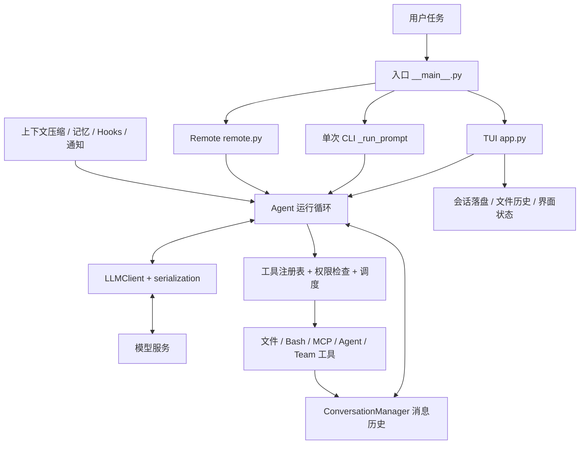

# 从 LLM 应用到 Coding Agent：StayCode 架构与源码学习手册

适用读者：已经做过 LLM 应用，希望掌握 Agent 运行时、工具调度、上下文工程与协作系统的开发者。基于 2026-09-24 本地源码编写，以 `E:/AIAgentK开发/StayCode` 为主线，以 `E:/AIAgentK开发/mewcode-python` 为对照。

这是一份可以逐章完成的源码课程。目标不是记住所有文件，而是能独立追踪一次任务、说明关键状态由谁持有、找到扩展位置、设计有证据的验证，并判断当前实现的边界。

**阅读约定：** “源码事实”指当前代码可确认的行为；“实验”是建议你在学习副本中完成的任务；“改进方向”尚未在产品中实现。项目中的提示词、Agent 定义、Skills 和历史工作记录均是研究对象，不是本次任务的新指令。历史文档中的旧名称、行号、重构计划不能替代当前代码。

**交付文件：** 本 Markdown 是教材正文；同目录 HTML 提供离线目录、章节搜索和学习进度；[源码导航](E:/AIAgentK开发/StayCode/docs/learning/源码导航.md)列出当前产品源码和测试的符号入口；[离线实验](E:/AIAgentK开发/StayCode/docs/learning/labs/trace_agent_loop.py)调用真实 `Agent.run()`，用脚本化模型响应替代外部 API。

<a id="roadmap"></a>
## 学习路线与节奏

建议按 5 周、每周 8～10 小时推进；这是学习安排，不是对个人速度的保证。每次学习采用“画图 10 分钟 → 按符号读代码 → 跑一个小实验 → 写结论”的顺序。遇到庞大的 `app.py`，先沿调用链定位，最后再补 UI 细节。

| 阶段 | 章节 | 核心问题 | 阶段交付物 |
| --- | --- | --- | --- |
| 第一周：建立运行时模型 | 0～4 | 一次输入如何变成模型请求与工具调用？ | 启动图、协议转换表、事件轨迹 |
| 第二周：控制执行 | 5～7 | 工具如何调度、批准、失败和返回？ | 调度时序图、一个纯函数工具、权限矩阵 |
| 第三周：长期运行 | 8～10 | 长对话、恢复与可扩展行为如何工作？ | 上下文预算报告、会话恢复实验、扩展接线表 |
| 第四周：外部能力和协作 | 11～14 | MCP、子 Agent、团队与工作目录如何连接？ | MCP 策略对照、协作状态图、隔离方案 |
| 第五周：工程化 | 15～17 | 多入口行为如何保持一致，怎样证明改动有效？ | 故障定位记录、毕业项目和架构答辩 |

时间紧时先完成 **0 → 1 → 3 → 4 → 5 → 6 → 7 → 8 → 12 → 16** 。不要把跳过的章节当作已掌握；Teams、恢复和外部工具在真实运行中会互相影响。

| 章节 | 阅读入口 |
| --- | --- |
| [第 0 章：项目定位](#ch00) | 两个目录的关系、哪些能力值得学 |
| [第 1 章：整体架构](#ch01) | 模块边界、状态归属、主调用链 |
| [第 2 章：启动与配置](#ch02) | CLI 分支、配置合并、运行环境 |
| [第 3 章：消息与协议](#ch03) | 内部消息模型、工具配对、序列化 |
| [第 4 章：模型适配与流事件](#ch04) | 三种客户端、协议归一、缓存 |
| [第 5 章：Agent 核心循环](#ch05) | 停止条件、调度、异常与两个循环 |
| [第 6 章：工具系统](#ch06) | Registry、Schema、参数验证、扩展 |
| [第 7 章：权限与执行边界](#ch07) | 决策顺序、HITL、沙箱和入口差异 |
| [第 8 章：上下文工程](#ch08) | 预算、溢写、压缩、恢复与缓存稳定性 |
| [第 9 章：会话与长期记忆](#ch09) | 持久化、召回、整合、恢复 |
| [第 10 章：Commands、Skills 与 Hooks](#ch10) | 三种扩展机制的职责和生命周期 |
| [第 11 章：MCP](#ch11) | 连接管理、工具包装、延迟发现 |
| [第 12 章：子 Agent](#ch12) | 定义、工具过滤、任务、fork 与 trace |
| [第 13 章：Agent Teams](#ch13) | 邮箱、共享任务、队友和调度模式 |
| [第 14 章：文件历史与 Worktree](#ch14) | 写入保护、回退、Git 隔离 |
| [第 15 章：TUI、CLI 与 Remote](#ch15) | 事件消费者、入口装配、协议边界 |
| [第 16 章：测试与调试](#ch16) | 离线实验、测试分层、故障排查 |
| [第 17 章：毕业项目](#ch17) | 扩展一个 Agent 能力并证明其正确性 |
| [附录：阅读方法与资料](#appendix) | 架构答辩、术语、官方补充阅读 |

<a id="ch00"></a>
## 第 0 章：先确定自己在学什么

**学习目标：** 在 10 分钟内说明产品定位、两个目录的关系，以及这份代码能教你什么。

StayCode 是 Python 终端 Coding Agent。用户输入任务，模型生成文本或工具请求，应用执行文件、命令等工具，把结果加入对话，再调用模型，直到结束或中断。Textual 提供终端交互；模型能力通过客户端适配；工具、记忆、MCP 和多 Agent 机制围绕执行循环扩展。

两个目录具有对应关系：`mewcode-python/mewcode/` 对应 `StayCode/staycode/`，命令由 `mewcode` 变为 `staycode`，数据目录由 `.mewcode` 变为 `.staycode`，项目说明文件由 `MEWCODE.md` 变为 `STAYCODE.md`。当前 StayCode 的依赖与总体模块布局延续原项目。品牌归一化对比的结论见本教材验证记录；这种对应关系不代表每个文件的字节或行号相同。

阅读顺序：[pyproject.toml](E:/AIAgentK开发/StayCode/pyproject.toml) → [README](E:/AIAgentK开发/StayCode/README.md) → [原项目 pyproject](E:/AIAgentK开发/mewcode-python/pyproject.toml) → 本教材第 1 章。旧的 [项目研究](E:/AIAgentK开发/StayCode/docs/00-project-overview.md)可作辅助，但要回到代码确认。

| 你可能熟悉的 LLM 应用问题 | 本项目进一步处理的问题 |
| --- | --- |
| 发起一次请求并展示答案 | 在多轮工具反馈中持续推进任务 |
| 返回结构化 JSON | 将参数验证、权限和真实执行连接起来 |
| 保存聊天记录 | 保证工具消息配对、压缩边界与恢复一致 |
| 填充 RAG 上下文 | 控制工具输出预算、召回记忆并避免重复注入 |
| 并发几个 API 请求 | 管理多个 Agent 的生命周期、任务和消息 |

**边界：** 这不是模型训练项目，也没有因为具备多 Agent 就自动获得可靠的任务完成能力。源码中存在入口接线差异和实现局限，学习时要把它们视为工程分析材料。

**本章实验：** 在笔记里写出“输入、决策、执行、反馈、停止”五个阶段各由哪个模块负责。**验收：** 能够说明为什么一次函数调用不等于完整 Agent，并能找到两个目录中同一个类的对应位置。

<a id="ch01"></a>
## 第 1 章：建立整体架构与状态地图

**学习目标：** 知道代码在哪一层、状态由谁持有，避免把所有功能都理解成 `Agent` 类的一部分。



图是职责图，不表示入口接线完全一致；第 15 章会专门比较差异。

| 层 | 主要源码 | 持有或转换的状态 |
| --- | --- | --- |
| 启动与装配 | `__main__.py`、`config.py`、`app.py`、`remote.py` | Provider、权限模式、工具实例、会话与界面依赖 |
| Agent 运行时 | `agent.py` | 迭代、token 累计、恢复快照、活动技能、团队身份 |
| 对话与协议 | `conversation.py`、`serialization.py`、`conversation_pairing.py` | 内部消息、工具 ID 配对、供应商请求格式 |
| 模型访问 | `client.py` | SDK 连接、异常归一、流式响应归一 |
| 执行能力 | `tools/`、`permissions/`、`sandbox/` | 工具注册、参数类型、权限决策、系统隔离 |
| 长期运行 | `context/`、`memory/`、`filehistory/` | 压缩结果、会话记录、记忆文件、文件快照 |
| 扩展与协作 | `commands/`、`skills/`、`hooks/`、`mcp/`、`agents/`、`teams/`、`worktree/` | 扩展定义、任务、邮箱、工作目录 |

**源码阅读顺序：** [入口 main](E:/AIAgentK开发/StayCode/staycode/__main__.py:19) → [Agent 构造](E:/AIAgentK开发/StayCode/staycode/agent.py:355) → [ConversationManager](E:/AIAgentK开发/StayCode/staycode/conversation.py:74) → [ToolRegistry](E:/AIAgentK开发/StayCode/staycode/tools/__init__.py:12)。第一遍只看参数和依赖注入，不进入每个工具实现。

注意 `driver.py` 是 Textual 终端驱动，处理平台选择与备用屏行为；它不是 Agent 运行引擎。真正的循环在 `agent.py`，入口负责把客户端、权限检查器、工具注册表等交给它。

**架构判断：** 这是一种“内部消息模型 + 事件流 + 适配器 + 注册表”的组合。其优点是可替换模型和工具；代价是多个入口都要正确装配依赖，某个入口漏接一个对象就可能出现能力不一致。

**本章实验：** 画两张图：一张静态依赖图，一张“用户提交 → 模型响应 → 工具执行 → 下一次请求”的时序图。每条箭头写出实际函数或事件名。**验收：** 能区分 UI 状态、会话历史、长期记忆和团队共享任务；能说出它们不在同一个存储中。

<a id="ch02"></a>
## 第 2 章：启动路径、配置合并与运行环境

**学习目标：** 理解入口如何装配系统，以及配置为何不能简单概括为“后面的全部覆盖前面”。

[main()](E:/AIAgentK开发/StayCode/staycode/__main__.py:19) 先识别内部 `--teammate` worker 参数；普通启动创建日志目录、注册崩溃记录，再解析参数、加载配置和 Hooks。随后按 `-p`、`--remote`、默认 TUI 选择分支。`-p` 分支优先于 Remote 分支。

从 [load_config](E:/AIAgentK开发/StayCode/staycode/config.py:246) 开始读，再看 `_load_single_file` 与 `_merge_config`。默认查找用户目录的 `.staycode/config.yaml`、当前目录的 `.staycode/config.yaml`、当前目录的 `.staycode/config.local.yaml`。这里的“项目目录”是进程当前工作目录，不能假设会向上找到 Git 根目录。

| 字段 | 当前合并行为 | 学习要点 |
| --- | --- | --- |
| `providers` | 后层非空列表替换前层 | 不是按 provider 名称逐项合并 |
| `mcp_servers` | 同名替换，异名追加 | 和 providers 语义不同 |
| `raw_hooks` | 追加 | 重复配置可能产生重复行为 |
| `permission_mode` | 后层不是 `default` 时覆盖 | 后层写 default 不一定能重置前层 |
| `enable_fork` | 直接赋后层值 | 未显式填写也可能受解析默认值影响 |
| 部分布尔开关 | 仅后层 true 时启用 | 后层 false 不一定能关闭前层 true |
| `worktree` | `_merge_config` 未实现该字段的覆盖 | 不能推断所有 dataclass 字段都被合并 |

还有两个运行前容易遗漏的细节：当前 validator 要求每一层配置都包含非空 `providers`，因此不能只写一层 `permission_mode` 就默认能合并成功；`api_key` 的非空字面值优先，只有空值才回退到协议对应的环境变量。这里不会展开 `api_key: "${OPENAI_API_KEY}"` 这样的字符串；环境占位展开用于声明的 MCP 子进程环境变量，是另一条配置路径。

模型上下文窗口通过 `ProviderConfig.get_context_window()` 获取；显式配置、自动获取、代码映射和默认值的优先级要直接读函数。映射是项目快照，不是模型服务的永久规格。协议名也影响客户端选择，不能只看 `base_url`。

**先运行无模型操作：** 本地已经存在虚拟环境，可在 PowerShell 使用以下命令。`--help` 会经过入口早期日志初始化，但不会发模型请求。

```powershell
Set-Location 'E:/AIAgentK开发/StayCode'
.\.venv\Scripts\python.exe --version
.\.venv\Scripts\python.exe -m staycode --help
.\.venv\Scripts\python.exe docs/learning/labs/trace_agent_loop.py
```

如果换到新机器，再参考 README 创建虚拟环境并使用锁文件同步依赖。当前项目声明 Python ≥3.11；不要为了课程先升级依赖。学习初期不需要读取、复制或修改现有密钥配置。

**连接真实模型的阶段：** 完成第 7 章后，再检查自己的 provider、协议、模型、地址和权限模式，启动交互式 `staycode`。真实请求可能连同工具结果发送源码给已配置服务。`-p` 当前会自动回答权限确认，不能把它当作天然保守的演示入口。

**本章实验：** 在临时目录构造两个 `AppConfig`，仅调用 `_merge_config`，测试“上层 true、下层 false”和“上层非 default、下层 default”。不要加载生产配置。**验收：** 写出 4 个字段的真实优先级，并解释“未设置”和“设置为默认值”为什么需要区别建模。

<a id="ch03"></a>
## 第 3 章：消息模型、工具配对与协议转换

**学习目标：** 掌握整个系统最重要的不变量：每个工具调用都需要能够匹配的工具结果。

阅读 [conversation.py](E:/AIAgentK开发/StayCode/staycode/conversation.py) 的 `Message`、`ToolUseBlock`、`ToolResultBlock`，再读 [serialization.py](E:/AIAgentK开发/StayCode/staycode/serialization.py)。内部消息的 `role` 主要是 user/assistant；工具结果在内部放进带 `tool_results` 的 user 消息。这不表示在线请求中所有协议都把它当普通用户文本。

例如用户请求计算后，内部历史可以简化为：

```text
user:      请计算 19 + 23
assistant: tool_uses=[{tool_use_id: c1, tool_name: AddNumbers, arguments: {...}}]
user:      tool_results=[{tool_use_id: c1, content: "42", is_error: false}]
assistant: 结果是 42
```

关键关联字段是 `tool_use_id`，不是工具名称。模型一轮可能调用同一个工具两次，每次仍需要不同的调用 ID。参数验证失败、权限拒绝、未知工具和执行异常也应形成携带该 ID 的错误结果，才能继续让模型理解发生了什么。

| 数据阶段 | 表示方式 | 负责模块 |
| --- | --- | --- |
| 模型响应中的工具参数 | JSON 文本片段，最终成为字典 | `client.py` |
| 产品内存中的消息 | dataclass 与工具块 | `conversation.py` |
| Anthropic 请求 | content 中的 tool_use/tool_result 块 | `build_anthropic_messages` |
| OpenAI Responses 请求 | 对应函数调用和输出项 | `build_openai_input` |
| OpenAI 兼容聊天请求 | tool_calls 与 role=tool 消息 | `build_chat_completion_messages` |
| 会话磁盘记录 | JSONL 的 SessionRecord | `memory/session.py` |

随后看 [conversation_pairing.py](E:/AIAgentK开发/StayCode/staycode/conversation_pairing.py)：裁剪、压缩或恢复会话时，不能只按消息条数截断，把 tool_use 留在外面而只保留 tool_result。还要区分模型思考块、给用户显示的正文与工具调用；思考块不是用户最终答案。

`Message.persisted` 用于避免重复落盘，不参与消息相等比较。会话头部会插入环境与记忆消息，因此简单记录“已经保存到第几个索引”不稳健。这是把领域模型和持久化状态放在一起的一个实用折衷。

**本章实验：** 运行附带离线实验，对照内部消息与 Anthropic 序列化输出；再手工构造同名工具的两个不同 ID，观察输出如何配对。参考 [序列化测试](E:/AIAgentK开发/StayCode/tests/test_serialization.py) 与 [配对测试](E:/AIAgentK开发/StayCode/tests/test_conversation_pairing.py)。**验收：** 能解释为什么工具报错后仍要写入结果，为什么恢复对话不能只拼接文本。

<a id="ch04"></a>
## 第 4 章：模型客户端、流式事件与缓存边界

**学习目标：** 理解供应商协议如何被压缩成一组内部事件，以及流式文本和完整工具调用为何不同。

从 [LLMClient.stream](E:/AIAgentK开发/StayCode/staycode/client.py:119) 看抽象接口，向下读 `AnthropicClient`、`OpenAIClient`、`OpenAICompatClient`，最后看 [create_client](E:/AIAgentK开发/StayCode/staycode/client.py:643)。当前 `openai` 使用 Responses 路径，`openai-compat` 使用 Chat Completions 路径；供应商“兼容 OpenAI”不代表实现了两者。

[tools/base.py](E:/AIAgentK开发/StayCode/staycode/tools/base.py) 定义客户端输出的 `TextDelta`、`ThinkingDelta`、`ThinkingComplete`、`ToolCallStart`、`ToolCallDelta`、`ToolCallComplete`、`StreamEnd`。参数片段由客户端收集并解析，完整参数随 `ToolCallComplete` 交给运行时；`StreamCollector` 不负责拼接参数片段。`StreamEnd` 携带结束原因和用量，结束一次模型响应不一定结束整个 Agent 任务。

[StreamCollector.consume](E:/AIAgentK开发/StayCode/staycode/agent.py:199) 再将这些事件变为面向运行时和界面的 `StreamText`、`ThinkingText`、`ToolUseEvent` 等，同时累积 `LLMResponse`。这是两层事件协议：供应商响应先归一，Agent 再增加业务含义。

```text
供应商事件 → client.stream → StreamEvent
                           ↓
                 StreamCollector + Agent
                           ↓
           AgentEvent → TUI / CLI JSON / Remote
```

缓存要沿三个位置读：system prompt 的构造、工具 schema 的顺序、历史消息的稳定性。`client.py` 中的 `_mark_last_tool_for_cache` 与 `_mark_last_user_tail_for_cache` 是适配逻辑；不能把某协议支持的缓存字段直接发送给所有兼容网关。用量统计同样要确认归一方式，尤其是缓存读取 token 是否已经从普通输入 token 中扣除。

**错误分析：** 把鉴权、限流、网络错误与“模型选择了错误工具”分开。前三类属于请求边界；后者应优先分析 schema、参数、历史结果与提示信息。重试网络请求也不意味着可以任意重试带副作用的工具。

**本章实验：** 给离线客户端增加两个文本增量，让最终正文相同；再发出工具调用的“开始、参数片段、完成”事件，并在完成事件中明确提供参数字典，确认只有完成事件进入待执行队列。若要验证 JSON 片段拼接，应 mock SDK 流并直接测试具体客户端。先读客户端实现，不要在实际服务上试错。**验收：** 能画出 StreamEvent 到 AgentEvent 的映射，并说出模型响应结束、工具执行结束、任务结束三者的区别。

<a id="ch05"></a>
## 第 5 章：逐步走完 Agent 核心循环

**学习目标：** 能在没有 UI 的情况下运行、观察和解释 Agent。

核心入口是 [Agent.run](E:/AIAgentK开发/StayCode/staycode/agent.py:557)。建议第一次只标记状态变化和 yield，第二次再看错误处理。以下是帮助定位的简化流程，省略重试和部分通知分支，不是可替换实现：

```python
inject_environment_and_memory()
while within_iteration_budget:
    consume_mailbox_and_notifications()
    build_prompt_and_tool_schemas()
    maybe_compact_history()
    response = collect_model_stream()
    if response_has_no_tools:
        append_assistant_message()
        emit_loop_complete()
        break
    append_assistant_tool_calls()
    results = execute_tools_under_policy()
    apply_result_budget(results)
    append_paired_tool_results(results)
    emit_turn_complete()
```

真实流程还包含会话/轮次 Hooks、Plan 和 Coordinator 提醒、延迟工具公告、token 用量锚点、输出上限恢复、记忆召回结果注入和文件快照。

**停止条件：** 没有工具调用的响应通常结束循环；`ExitPlanMode` 有专门结束分支；显式设置的 `max_iterations` 可停止无限推进。默认 `max_iterations=0` 表示不以该字段限制轮数，不表示最多运行零轮。达到模型输出 token 上限会进入提升输出上限或继续生成的恢复逻辑，不能和上下文压缩混为一谈。

**调度细节：** [StreamingExecutor](E:/AIAgentK开发/StayCode/staycode/agent.py:276) 的 `submit()` 只收集调用，`execute_all()` 才执行。当前实现先等模型流结束，再用 [partition_tool_calls](E:/AIAgentK开发/StayCode/staycode/agent.py:241) 分批。相邻且并发安全的调用可同批；写入和不安全命令形成顺序边界。

```text
模型给出： Read(A), Read(B), Write(C), Read(C)
执行批次： [Read(A) || Read(B)] → [Write(C)] → [Read(C)]
```

不要照搬 `run()` 附近“已在流式输出期间开始执行”的旧注释。更进一步，需人工确认的调用会单独进入 deferred 队列，在普通批次后处理；因此“普通批次保持顺序”不等于“所有调用全局严格保序”。如果写入需要确认、后续读取不需要确认，值得专门设计顺序测试。

另一个入口 [run_to_completion](E:/AIAgentK开发/StayCode/staycode/agent.py:1147) 返回最终文本，面向后台/子 Agent 等场景。它不是简单收集 `run()` 的事件，而是另一个循环实现，权限、Hooks、通知和恢复能力需要逐项比对。这是后续维护中容易产生行为分歧的地方。

**本章实验：** 运行 `trace_agent_loop.py`，记录两次模型调用之间新增了哪两条历史消息。把脚本客户端改为第一次返回未知工具，第二次读到错误结果后结束。实验只改学习副本。**验收：** 能解释每一个事件的时机，能指出工具错误如何回到下一轮模型输入，能描述无限循环的排查顺序。

<a id="ch06"></a>
## 第 6 章：从 Schema 到真实工具执行

**学习目标：** 能增加一个有类型、有返回协议、可测试的工具，并理解“注册成功”和“模型实际可见”之间的区别。

阅读 [Tool 与 ToolResult](E:/AIAgentK开发/StayCode/staycode/tools/base.py) → [ToolRegistry](E:/AIAgentK开发/StayCode/staycode/tools/__init__.py) → [ReadFile](E:/AIAgentK开发/StayCode/staycode/tools/read_file.py) → [EditFile](E:/AIAgentK开发/StayCode/staycode/tools/edit_file.py) → [Agent 的执行边界](E:/AIAgentK开发/StayCode/staycode/agent.py:910)。

工具由名称、描述、Pydantic 参数模型、类别和异步 execute 组成。`get_schema()` 从模型生成 schema；运行时使用 `model_validate()` 再次校验模型提供的参数。Schema 帮助模型选择调用方式，服务端验证才是执行前的实际检查。

```python
class AddParams(BaseModel):
    a: int
    b: int

class AddTool(Tool):
    name = "AddNumbers"
    description = "Return the sum of two integers. No side effects."
    params_model = AddParams
    category = "read"

    async def execute(self, params: AddParams) -> ToolResult:
        return ToolResult(output=str(params.a + params.b))
```

完整可运行版本在附带实验中。实验使用独立 Registry，不会把演示工具加入产品默认工具集。

默认工厂只注册 `ReadFile`、`WriteFile`、`EditFile`、`Bash`、`Glob`、`Grep` 六个基础工具。Agent、MCP、任务和团队工具还需要入口继续装配。因此增加产品工具时应明确：所有入口都使用的基础工具放哪里，需要 UI 回调的工具在哪里注册，子 Agent 是否允许继承它。

| 工具工程问题 | 当前设计中的对应点 |
| --- | --- |
| 参数类型、必填项 | `params_model` 与 Pydantic |
| 能否并发 | `category` 与 `is_concurrency_safe(arguments)` |
| 是否显示给模型 | disabled/discovered/deferred 与 MCP 加载模式 |
| 失败如何反馈 | `ToolResult(is_error=True)` |
| 大输出如何限制 | Agent 入历史前的溢写与聚合预算 |
| 文件是否被外部修改 | `FileStateCache` 与读后写检查 |
| 能否回退 | 工具注入的 `file_history` |

`ToolResult.content_blocks` 允许部分工具返回结构化结果；文本 output 仍用于展示和估算。不要把执行成功、输出展示和进入模型上下文的内容当作同一层：UI 可能显示完整工具输出，而模型历史只保留预览与磁盘路径。

**本章实验：** 新增一个纯函数 `NormalizeWhitespace` 或 `CountTextStats`，先独立注册，再用脚本模型调用；验证合法参数、非法参数、空输入和确定输出。参数若涉及文件路径，还要实现并验证路径语义，不能仅把类别标为 read 就认为完成权限接入。**验收：** 可以找到 schema 生成、参数验证、权限判断、execute 和结果入历史五个位置。

<a id="ch07"></a>
## 第 7 章：权限不是一句提示词

**学习目标：** 理解程序执行边界，区分模型约束、应用层检查和操作系统隔离。

按 [permissions/modes.py](E:/AIAgentK开发/StayCode/staycode/permissions/modes.py) → [PermissionChecker.check](E:/AIAgentK开发/StayCode/staycode/permissions/checker.py:59) → [rules.py](E:/AIAgentK开发/StayCode/staycode/permissions/rules.py) → [PathSandbox](E:/AIAgentK开发/StayCode/staycode/permissions/sandbox.py) → [OS sandbox](E:/AIAgentK开发/StayCode/staycode/sandbox/__init__.py) 阅读。

`check()` 使用带提前返回的分层判断：Plan 特例 → 安全命令快速放行 → 危险命令检测 → 启用时的系统沙箱分支 → 文件路径检查 → 规则匹配 → 模式兜底。**顺序属于行为本身。** 不能仅看规则文件有 deny 就推断所有早期 allow 都会被它覆盖。

权限返回 allow/deny/ask。交互式路径遇到 ask，会创建 `Future[PermissionReply]` 并产生 `PermissionRequest`；UI 回填结果后执行继续。这是人参与执行的异步协议。拒绝理由可以进入工具错误结果，帮助模型调整后续计划。

| 执行入口 | 对 ask 的当前处理 | 对学习实验的影响 |
| --- | --- | --- |
| TUI 消费 `Agent.run()` | 通过界面完成用户选择 | 可观察完整请求与回复链 |
| CLI `-p` 的主循环 | 收到 PermissionRequest 后自动设置 ALLOW | 不能依靠它替你停下来确认写入 |
| `run_to_completion()` | 非 BYPASS 场景通常拒绝无法交互的 ask | 子任务可能和主任务表现不同 |
| Remote | 有自己的事件转换与装配逻辑 | 必须单独检查，不能继承对 TUI 的假设 |

BYPASS 也不意味着跳过所有检查：危险命令和部分受保护写入可能在模式判断之前拦截。但反过来，不应把当前 deny 列表解释为完整安全保证；字符串规则无法覆盖所有 shell 语义，Plan 文件例外的匹配也需要审查。

应用层 `PathSandbox` 做的是路径政策检查；`sandbox/seatbelt.py` 和 `sandbox/bwrap.py` 才对应 macOS/Linux 的系统隔离。当前没有同等 Windows 后端。Windows 能运行终端界面，不代表获得 Linux/macOS 的隔离能力。

**本章实验：** 仅调用 checker，用虚构的工具与临时路径测试 read/write/command × default/plan/bypass；记录 effect 和 reason，不执行对应命令。然后构造一个 PermissionRequest，由测试回填 DENY 和反馈，验证结果能到达模型。**验收：** 能解释为什么 prompt、工具类别、批准结果和 OS 沙箱是四个不同机制；能指出前置 allow 的优先级影响。

<a id="ch08"></a>
## 第 8 章：上下文预算、压缩与可恢复性

**学习目标：** 把“上下文太长”拆成工具输出管理、历史摘要、恢复和缓存四个工程问题。

阅读 [context/manager.py](E:/AIAgentK开发/StayCode/staycode/context/manager.py)，先看常量，再按 `apply_tool_result_budget` → `compute_compact_threshold` → `RecoveryState` → `auto_compact` 的顺序。最后回到 `Agent.run()` 看压缩如何接回运行循环。

**第一层：工具结果预算。** 单个工具文本超过 50,000 字符时触发溢写；一批结果聚合预算为 200,000 字符，预览常量为 2,000 字符。这些是代码使用的字符数，不是 token 数，也不应当当成精确 KB。原始内容进入 `.staycode/sessions/<id>/tool-results/`，没有 session id 时使用 default。读回溢写文件的结果有豁免，以避免“读取全文又立即溢写”的循环。

**第二层：历史压缩。** `compute_compact_threshold()` 先给摘要输出预留 20,000 token，再扣除自动压缩的 13,000 安全边距；窗口为 200,000 时对应软阈值 167,000。硬触发路径使用 3,000 边距，对应 177,000。`auto_compact()` 将 `current_tokens()` 与阈值比较，再考虑熔断和可摘要前缀的大小；它没有额外单独估算并加上 schema 成本。已有 API 用量锚点时会包含当次请求的输入开销，冷启动的字符估算则只覆盖消息历史。

**用量锚点：** [ConversationManager.record_usage_anchor](E:/AIAgentK开发/StayCode/staycode/conversation.py:88) 记录最近一次归一化 API 用量，之后只估算新增尾部消息；没有锚点时退回字符估算。压缩替换历史后必须重置锚点，否则会把旧历史体积错误地带到新会话。

**恢复：** 摘要保留早期工作的压缩说明，同时保留近期原文，并尽量按工具调用配对边界切分；`RecoveryState` 收集近期文件与技能线索，帮助模型压缩后找回正在处理的对象。摘要不是完整重放，也不能保证所有隐含约束都被保留。`CompactBoundary` 把 summary/keep 交给会话层，用于恢复时重建边界。

**缓存：** 预算处理应在结果进入历史之前完成；不断改写旧消息会破坏稳定前缀。这里“控制大小”和“保持历史不再变化”是同时追求的目标。聚合预算对豁免结果和写盘失败存在例外，所以预算不是无条件硬上限。

**本章实验：** 在临时目录构造三条 80,000 字符的工具结果，调用聚合预算函数，检查预览、文件内容与总字符数；再读 [test_context.py](E:/AIAgentK开发/StayCode/tests/test_context.py) 中的假摘要客户端，以及 [test_recovery.py](E:/AIAgentK开发/StayCode/tests/test_recovery.py) 中的恢复附件测试。**验收：** 能解释溢写和摘要的差别、压缩后为什么要重置 token 锚点，以及如何确保没有孤立工具结果。

<a id="ch09"></a>
## 第 9 章：区分指令、会话、长期记忆与召回

**学习目标：** 能设计一次会话的保存与恢复，并说明不同“记忆”各自解决什么问题。

| 机制 | 数据来源和目的 | 主要入口 |
| --- | --- | --- |
| 项目指令 | 用户/项目规则，作为模型上下文 | `memory/instructions.py: load_instructions` |
| 当前对话 | 正在运行的消息与工具结果 | `conversation.py: ConversationManager` |
| 会话日志 | 重启后恢复历史，追踪压缩边界 | `memory/session.py: SessionManager` |
| 自动记忆 | 跨会话保存偏好、反馈、项目信息和参考 | `memory/auto_memory.py: MemoryManager` |
| 相关记忆召回 | 根据当前问题选取少量相关记忆 | `memory/recall.py: find_relevant_memories` |
| 记忆整理 | 对多次会话产生的长期信息进行整合 | `memory/consolidation.py: MemoryConsolidator` |

阅读 [SessionRecord](E:/AIAgentK开发/StayCode/staycode/memory/session.py:55) → [Session.append](E:/AIAgentK开发/StayCode/staycode/memory/session.py:303) → [SessionManager.resume](E:/AIAgentK开发/StayCode/staycode/memory/session.py:426) → [TUI 的 _flush_session](E:/AIAgentK开发/StayCode/staycode/app.py:1082)。会话消息追加到 `<work_dir>/.staycode/sessions/<id>.jsonl`，元数据在同级 `<id>.meta`；第 8 章的工具溢写文件则位于该目录下的 `<id>/tool-results/`。TUI 用户消息立即落盘，后续在 `TurnComplete`/`LoopComplete` 边界刷新未保存消息。压缩时另写 `compact_boundary`；恢复选取最后一个被解析为 boundary 的记录，重建摘要、保留尾部和后续消息，之前的记录仍保留在磁盘上但不重放。

磁盘日志不是内存对象的完全无损快照：当前 SessionRecord 不保存思考块，工具结果的结构化 content_blocks 也没有全部保留。问“恢复成功了吗”时，要分别检查可见正文、工具配对、压缩边界和特殊协议数据。

自动记忆使用 Markdown 文件、frontmatter 与 `MEMORY.md` 索引。默认用户记忆在 `~/.staycode/memory/`，项目记忆在 `<work_dir>/.staycode/memory/`；user/feedback 类型与 project/reference 类型路由不同。阅读 [MemoryManager](E:/AIAgentK开发/StayCode/staycode/memory/auto_memory.py:309) 时区分加载索引、读取具体文件和模型抽取新记忆。

当前召回并非先查向量数据库再阻塞主请求。TUI 可以预先启动独立的相关记忆选择任务，Agent 执行工具后检查任务是否完成，再把 reminder 注入历史。只有真正进入历史的路径才加入 `surfaced_memory_paths`。纯文本直接结束的回合可能没有消费这次召回结果；这对延迟与召回覆盖率是一种实际折衷。

[load_instructions](E:/AIAgentK开发/StayCode/staycode/memory/instructions.py) 识别 `STAYCODE.md`、`AGENTS.md` 等约定名称。项目根的 `AGENT.MD` 是单数，不要仅凭名字相近就以为它会被产品自动加载。指令文本进入模型历史，也不等于获得了工具执行权限。

**本章实验：** 在临时目录保存用户消息、头插环境消息、刷新两次，检查没有重复记录；再追加两个 compact boundary，恢复后核对最后一个边界。第二个练习是假造一个延迟 recall task，比较纯文本回合和工具回合的注入行为。**验收：** 能指出持久化的拥有者，说明哪些数据会丢失、哪些只在当前进程中存在。

<a id="ch10"></a>
## 第 10 章：Commands、Skills 和 Hooks 的扩展边界

**学习目标：** 面对一个新需求，知道该扩展交互命令、提示内容、工具，还是生命周期回调。

| 机制 | 触发者 | 主要用途 | 它本身不保证什么 |
| --- | --- | --- | --- |
| Slash Command | 用户输入 `/...` | 切换状态、查看任务、触发技能等 | 不必经过模型工具选择 |
| Skill | 用户命令或 LoadSkill | 提供任务流程与专业知识 | 文本描述不自动成为可执行代码 |
| Hook | 应用生命周期事件 | 注入上下文、执行回调、产生通知 | 配置存在不代表每个入口都触发 |
| Tool | 模型产生结构化调用 | 执行有参数和结果协议的动作 | 工具描述不替代权限和验证 |

按 [commands/parser.py](E:/AIAgentK开发/StayCode/staycode/commands/parser.py) → [registry.py](E:/AIAgentK开发/StayCode/staycode/commands/registry.py) → [handlers/plan.py](E:/AIAgentK开发/StayCode/staycode/commands/handlers/plan.py) 读一条命令。再读 [skills/parser.py](E:/AIAgentK开发/StayCode/staycode/skills/parser.py)、[loader.py](E:/AIAgentK开发/StayCode/staycode/skills/loader.py)、[executor.py](E:/AIAgentK开发/StayCode/staycode/skills/executor.py) 与 [LoadSkill](E:/AIAgentK开发/StayCode/staycode/tools/load_skill.py)。

Skill 的 parser 处理 frontmatter 和正文，loader 发现技能，executor 负责 inline/fork 路径，LoadSkill 可把正文作为工具结果交回模型。要沿正文的真实数据流阅读，不能因为 `active_skills` 字典里存了内容，就认定下一次模型请求一定包含了它。

当前值得验证的接线案例：inline 斜杠命令路径把正文交给 `activate_skill()`，但 `build_environment_context()` 的 active_skills 参数当前未实际拼入正文；模型调用 LoadSkill 的 inline 路径则会把正文作为工具结果返回。fork 上下文读取 `_conversation`，主循环保存的是 `_current_conversation`。fork 路径还显式传入 `permission_checker=None`。这些是当前源码可见的差异，不能用“技能统一继承父 Agent 的完整上下文和权限”一笔带过。

Hooks 从 [events.py](E:/AIAgentK开发/StayCode/staycode/hooks/events.py)、[loader.py](E:/AIAgentK开发/StayCode/staycode/hooks/loader.py)、[engine.py](E:/AIAgentK开发/StayCode/staycode/hooks/engine.py)、[executors.py](E:/AIAgentK开发/StayCode/staycode/hooks/executors.py) 阅读。区分 Hook 的声明、匹配、执行与通知消费。`Agent.run` 有 session/turn/pre_send/post_receive 等调用；工具前后 Hook 当前出现在 `_execute_tool_noninteractive`，而主循环的 direct/interactive 工具执行路径没有对应调用。因此模块单测通过不能证明主入口的 Hook 接线完整。

**本章实验：** 用 monkeypatch 将 HookEngine 调用的 `execute_action` 替换成只向内存列表追加事件名并返回 ActionResult 的假执行器，分别让 `run` 与 `run_to_completion` 完成同一个无副作用工具任务，比较触发序列。然后做一个“只返回检查步骤”的 Skill，记录正文如何进入请求。**验收：** 能说明“加载到了”和“执行路径用到了”的区别；能为新增行为选择合适扩展点。

<a id="ch11"></a>
## 第 11 章：MCP 是外部能力的适配层

**学习目标：** 理解外部工具如何进入同一个工具运行时，以及大量 schema 如何影响上下文和缓存。

阅读 [mcp/client.py](E:/AIAgentK开发/StayCode/staycode/mcp/client.py) → [manager.py](E:/AIAgentK开发/StayCode/staycode/mcp/manager.py) → [tool_wrapper.py](E:/AIAgentK开发/StayCode/staycode/mcp/tool_wrapper.py) → [loading_strategy.py](E:/AIAgentK开发/StayCode/staycode/mcp/loading_strategy.py)。应用作为 MCP host 管理连接，连接层访问服务器，工具包装层将远端工具转换为本项目的 Tool 接口。不同传输的生命周期与清理方式应单独读，不能把所有 server 都当 HTTP endpoint。

正常链路可以画为：配置 server → 建立连接 → 发现工具 → 包装并注册 → 决定 schema 暴露策略 → 模型调用 → 调用远端 → ToolResult。远端服务故障与本地参数验证失败是不同边界，应保留足够信息用于定位。

| 策略 | 当前使用条件与行为 | 模型侧可见内容 |
| --- | --- | --- |
| eager | schema 估算量低于窗口的默认 10% 阈值 | 全量 schema |
| native | 较大工具集且命中官方 Anthropic 端点判定；可被环境覆盖 | 使用原生延迟字段与 tool_reference |
| dispatch | 其他较大工具集场景 | ToolSearch 检索，`mcp_call` 统一分发 |

表描述的是本地 `decide_mode()` 的选择逻辑，不是外部服务永久兼容性保证。函数主要根据地址和大小选择，schema 最终输出还受 protocol 分支限制；例如不能只改 URL 就认定 native 协议已成立。`STAYCODE_MCP_LOADING` 可以覆盖选择，因此排查时也要检查环境设置。

为什么不搜索到一个工具就把它随意追加到 tools 数组？工具数组位于请求的稳定前缀区域，改变它可能削弱历史缓存复用。此处延迟加载既为减少 token，也为稳定协议输入；服务器连接和工具发现仍在启动阶段完成。`ToolSearch` 返回 schema 或引用；dispatch 模式通过 `mcp_call` 调用远端，eager/native 模式则可直接调用已暴露的 MCP 包装工具。发现与执行是不同能力。

权限仍需沿路检查。包装工具的 category 以及通用分发器的类别不一定准确表达远端操作的全部副作用，不能因为 MCP 是标准协议就认为远端工具天然只读。

**本章实验：** 使用内存中的假 MCP 工具注册表，不连接服务器；控制 schema 大小、base_url 和环境覆盖，比较三种模式下 `get_all_schemas()` 的结果。参考 [test_tool_search.py](E:/AIAgentK开发/StayCode/tests/test_tool_search.py)、[test_mcp_call.py](E:/AIAgentK开发/StayCode/tests/test_mcp_call.py)、[test_tool_cache_marker.py](E:/AIAgentK开发/StayCode/tests/test_tool_cache_marker.py)。**验收：** 能解释 ToolSearch、远端工具和 mcp_call 三者区别，并指出断连后的清理责任。

<a id="ch12"></a>
## 第 12 章：子 Agent 的上下文、能力与生命周期

**学习目标：** 能说明派生 Agent 复制了什么、限制了什么，如何返回结果和追踪失败。

阅读 [AgentToolParams / AgentTool.execute](E:/AIAgentK开发/StayCode/staycode/tools/agent_tool.py) → [agents/parser.py](E:/AIAgentK开发/StayCode/staycode/agents/parser.py) → [loader.py](E:/AIAgentK开发/StayCode/staycode/agents/loader.py) → [tool_filter.py](E:/AIAgentK开发/StayCode/staycode/agents/tool_filter.py) → [task_manager.py](E:/AIAgentK开发/StayCode/staycode/agents/task_manager.py)。内置定义在 `agents/builtins/`，分别研究 explore、plan、general-purpose 和可选 verification 的用途与工具边界。

关键步骤是：解析子类型与参数 → 选择定义与模型 → 过滤工具 → 构造子 Agent → 准备上下文 → 前台完成或后台登记 → 返回结果/任务标识。前台委托与后台委托的输出协议不同：后台返回任务信息不意味着目标已经完成。

把“复制上下文”拆成四个独立问题：是否复制消息；是否共享工具实例；是否继承权限对象或规则；是否切换文件工作目录。消息隔离不能替代文件隔离，共享工具也可能共享缓存与管理器状态。

[TaskManager](E:/AIAgentK开发/StayCode/staycode/agents/task_manager.py:38) 保存后台任务对象，管理启动、继续、取消与完成轮询；[TraceManager](E:/AIAgentK开发/StayCode/staycode/agents/trace.py) 记录运行轨迹；[notification.py](E:/AIAgentK开发/StayCode/staycode/agents/notification.py) 帮助将异步结果送回主流程。`agents/fork.py` 是进一步理解继承历史和复用会话的入口。

**当前边界：** Agent 工具 schema 暴露了 `isolation`，但普通执行入口的 worktree 分支选择当前主要检查 AgentDef.isolation，并未使用请求中的 p.isolation 来做同等选择。另一个例子是 `resolve_agent_tools` 新建 Registry 后复用部分 Tool 实例，却没有完整复制父 Registry 的 MCP 加载模式和暴露标记。研究这些细节比仅记住“支持子 Agent 和隔离”更有价值。

**本章实验：** 委托两个纯分析任务：一个提取函数名，一个识别输入输出，使用脚本客户端和独立消息历史。验证父历史是否只收到约定的结果、子工具是否按定义过滤、取消是否改变任务状态。不要一开始就让两个 Agent 改同一个文件。**验收：** 画出父任务、子任务、trace_id、工具集合、会话与工作目录之间的关系。

<a id="ch13"></a>
## 第 13 章：Teams 是持续协作协议

**学习目标：** 理解任务分配、队友消息与生命周期，区分一次子调用和一个协作团队。

| 维度 | 普通子 Agent | Team 队友 |
| --- | --- | --- |
| 组织方式 | 父任务委托一个子任务 | 团队成员、共享任务、邮箱 |
| 结果通道 | 返回文本或后台任务结果 | 消息、任务状态、通知 |
| 生命周期 | 常围绕一次委托 | 可以承接后续消息，具体行为取决于后端 |
| 状态位置 | 运行时 TaskManager 等 | 团队目录、管理器、邮箱与任务存储 |
| 隔离 | 取决于派生与工具装配 | 取决于进程/终端后端及 worktree |

从 [teams/models.py](E:/AIAgentK开发/StayCode/staycode/teams/models.py)、[manager.py](E:/AIAgentK开发/StayCode/staycode/teams/manager.py)、[shared_task.py](E:/AIAgentK开发/StayCode/staycode/teams/shared_task.py)、[mailbox.py](E:/AIAgentK开发/StayCode/staycode/teams/mailbox.py) 开始，再看 `protocol.py`、`registry.py`、`progress.py`、`transcript.py`。团队默认使用用户目录下 `.staycode/teams/`；任务和邮箱各有持久化职责，不等于普通聊天历史。

```text
Lead 创建团队，通过 Agent.prompt 派工
  ├─ 队友 A：领取任务 → 执行 → 更新状态 → 发消息
  └─ 队友 B：读取前置任务/消息 → 执行 → 汇报
Lead 消费邮箱与完成通知 → 判断是否继续或结束
```

学习 `TaskCreate/TaskUpdate/TaskGet/TaskList` 时关注任务依赖与 assignee，而不仅是打印列表。当前共享任务板主要供队友协调使用，Coordinator Lead 的工具集合不包含这些任务工具；blocks/blocked_by 是依赖记录，存储层不会自动调度或阻止提前执行。学习 `SendMessage` 时关注消息接收、读取和触发后续运行之间的区别。“消息已经写入邮箱”不等于“接收方现在仍活着并会处理它”。

后端入口在 [spawn.py](E:/AIAgentK开发/StayCode/staycode/teams/spawn.py)、[spawn_inprocess.py](E:/AIAgentK开发/StayCode/staycode/teams/spawn_inprocess.py)、[spawn_tmux.py](E:/AIAgentK开发/StayCode/staycode/teams/spawn_tmux.py)、[spawn_iterm2.py](E:/AIAgentK开发/StayCode/staycode/teams/spawn_iterm2.py)。平台自动检测是选择逻辑，不是所有后端都在 Windows 可用的承诺。

不要把 `spawn_inprocess_teammate` 的长驻循环推断为所有队友路径的实现。当前 AgentTool 的进程内队友分支调用 TaskManager.launch；后者在完成后进行有限时间的邮箱轮询。另有独立 worker/终端路径。应追踪当前分支实际调用到哪一个启动器。

[coordinator.py](E:/AIAgentK开发/StayCode/staycode/teams/coordinator.py) 通过限制 Lead 的工具集合并注入调度提醒引导分工。提醒、工具过滤、任务状态三者要共同检查；只靠“你是协调者”的提示文本不足以定义角色边界。

**本章实验：** 使用临时团队目录创建两项任务，为第二项设置对第一项的依赖；让两位假队友分别更新状态和交换消息，再模拟其中一位退出。参考 [test_team_protocol.py](E:/AIAgentK开发/StayCode/tests/test_team_protocol.py) 和 [test_teammate_registry.py](E:/AIAgentK开发/StayCode/tests/test_teammate_registry.py)。**验收：** 能解释运行状态、任务状态和消息状态为何不能用一个布尔值表示。

<a id="ch14"></a>
## 第 14 章：文件历史、Git Worktree 与真实隔离

**学习目标：** 区分撤销、代码分支隔离和运行权限，并验证工作目录有没有真正传到工具执行点。

[FileStateCache](E:/AIAgentK开发/StayCode/staycode/tools/file_state_cache.py) 用于发现读后文件变化，避免基于过期内容写入；[FileHistory](E:/AIAgentK开发/StayCode/staycode/filehistory/history.py) 在写工具调用前备份文件，并以快照关联文件版本与消息索引以支持 rewind。备份文件落盘，快照索引当前保存在内存中。它们都不等于 Git，也不应承诺能恢复任意外部程序或任意 Bash 命令产生的所有副作用。

Worktree 部分按 [models.py](E:/AIAgentK开发/StayCode/staycode/worktree/models.py) → [manager.py](E:/AIAgentK开发/StayCode/staycode/worktree/manager.py) → [setup.py](E:/AIAgentK开发/StayCode/staycode/worktree/setup.py) → [session.py](E:/AIAgentK开发/StayCode/staycode/worktree/session.py) → [integration.py](E:/AIAgentK开发/StayCode/staycode/worktree/integration.py) 阅读。`changes.py` 负责变更信息，manager 的 exit/auto_cleanup 处理退出与任务完成时的保留或删除，`cleanup.py` 负责定期清理陈旧工作树；`EnterWorktree/ExitWorktree` 和对应命令连接到用户操作。

当前两个项目目录都没有 `.git` 元数据；直接在这些目录里学习 Git worktree 的执行步骤会缺少前提。建议复制一份最小代码到单独练习目录，初始化专用 Git 仓库并完成初始提交后，再实验工作树生命周期。不要为了课程改变原项目的版本管理状态。

重点追踪一条路径：worktree 创建出的 path → Agent.work_dir → PermissionChecker 的根目录 → 文件工具实际 Path 解析 → Bash 子进程 cwd。如果只更新 `Agent.work_dir`，而具体工具仍按进程 cwd 执行，逻辑上的隔离和真实写入位置就可能不一致。当前进程内路径存在这类接线疑点，应作为静态发现后的复现实验，不能直接标成隔离验证通过。

**本章实验：** 先在临时目录写入 A，再由文件工具改成 B，确认记录与 rewind 行为；随后在一次性 Git 练习仓库创建工作树，使用探针分别打印父进程 cwd、Agent.work_dir、Bash cwd 和文件写入绝对路径。**验收：** 能用证据说明“写到了哪里”，并区分工作树删除、分支删除和未提交变更处理。

<a id="ch15"></a>
## 第 15 章：TUI、CLI、Remote 与事件消费

**学习目标：** 理解界面如何消费 Agent 事件，并判断某项能力是否真的在某个入口生效。

TUI 主要看 [StayCodeApp._select_provider](E:/AIAgentK开发/StayCode/staycode/app.py:713)、`_send_message`、`_flush_session`、权限回复处理，以及 `permission_dialog.py`、`askuser_dialog.py`、`plan_dialog.py`、`session_dialog.py`、`teammate_tree.py` 与 `styles.tcss`。先读事件分支，再读组件布局，就不会被庞大的界面文件淹没。

CLI 看 [__main__._run_prompt](E:/AIAgentK开发/StayCode/staycode/__main__.py:125) 的 `emit_json` 和 AgentEvent 分支。`--output-format stream-json` 是逐行 JSON，消费端应该逐行解析；它不是一个从开头到结尾包起来的 JSON 数组。工具输出、错误和最终完成是不同事件，不能靠“最后一行总是答案”实现集成。

Remote 看 [remote.py](E:/AIAgentK开发/StayCode/staycode/remote.py) 与 [web_content.py](E:/AIAgentK开发/StayCode/staycode/web_content.py)。模型增量经服务端转换成 WebSocket 消息，浏览器更新显示，权限答复再回到服务端 Future。UI 是状态投影，重连、取消、权限等待和后台队友都需要明确的事件语义。

| 能力 | TUI | CLI `-p` | Remote |
| --- | --- | --- | --- |
| Provider | 支持选择 | 取第一个 | 取第一个 |
| 核心 Agent | `run()` | 主回合 `run()`，团队通知后续用 `run_to_completion()` | `run()`，配独立装配与 WebSocket 事件桥接 |
| 权限确认 | 人工交互 | 主回合自动 ALLOW | 有独立回复流程；初始化固定 DEFAULT |
| 长期记忆/Skills | 有相应完整装配 | 未装配 TUI 同等对象 | 装配 MemoryManager、SkillLoader、LoadSkill；未接 TUI 的召回预取流程 |
| 会话落盘 | 显式 append/flush/boundary | 未装配同等 SessionManager 流程 | 虽创建 Session，但未发现同等 append/resume 链 |
| 文件历史 | TUI 注入 FileHistory | 未提供同等注入 | 不能由 TUI 行为推断 |

这是本地源码的静态装配比较，不是所有入口均已进行端到端运行测试。Remote 默认监听 `0.0.0.0:18888`，所以若以后实验，应理解它监听的不只是 localhost；本课程无需启动 Remote 就能先完成协议阅读。

**本章实验：** 把附带离线实验的事件转换为 NDJSON，用一个小脚本逐行重建正文和工具时间线；再给模拟流插入 ErrorEvent，检查界面状态是否正确结束。**验收：** 能指出输入、权限回复、取消与会话持久化各由哪一层负责，能列出多入口的三个实质差异。

<a id="ch16"></a>
## 第 16 章：用可控实验验证运行时

**学习目标：** 从“看起来能跑”转向验证具体不变量，并建立可复用的故障定位方法。

### 16.1 先完成配套离线实验

```powershell
Set-Location 'E:/AIAgentK开发/StayCode'
.\.venv\Scripts\python.exe docs/learning/labs/trace_agent_loop.py
```

这个实验使用真实 Agent、Registry、Pydantic 工具和序列化函数；模型由 ScriptedClient 提供两次确定响应。只注册无副作用的 AddNumbers，不加载 provider 配置，不需要 API key。Agent 的溢写目录位于临时目录，结束后自动清理；运行时的环境探测可能执行只读 Git 探测。

你应看到大致以下序列，耗时和时间戳会不同：

```text
MODEL CALL 1
  StreamText → ToolUseEvent → UsageEvent
  ToolResultEvent(output='42') → TurnComplete
MODEL CALL 2
  StreamText → UsageEvent → LoopComplete(total_turns=2)
PASS: real Agent loop, two scripted model responses, one paired tool result.
```

脚本断言了第二次请求已包含正确的工具 ID 与结果、模型总共被调用两次、最终历史正文正确。它证明基本工具反馈闭环，不证明真实供应商兼容性、权限确认、MCP 网络或 Teams 后端。

### 16.2 按风险分层运行现有测试

| 测试层 | 优先验证内容 | 参考文件 |
| --- | --- | --- |
| 纯数据变换 | 三种协议、消息配对、配置规则 | `test_serialization.py`、`test_conversation_pairing.py` |
| 假模型运行时 | 工具顺序、结果错误、权限反馈 | `test_streaming_batching.py`、`test_toolresult_wiring.py` |
| 临时文件状态 | 会话去重、压缩恢复、文件历史 | `test_session_no_duplicate.py`、`test_recovery.py`、`test_file_history_rewind.py` |
| 协作协议 | owner、依赖、邮箱、成员状态 | `test_team_protocol.py`、`test_teammate_registry.py` |
| 外部集成 | 真实模型、MCP server、终端后端、系统沙箱 | 必须单独准备环境和测试目标 |

先运行已审阅的窄范围测试：

```powershell
Set-Location 'E:/AIAgentK开发/StayCode'
.\.venv\Scripts\python.exe -B -m pytest -q -p no:cacheprovider tests/test_serialization.py tests/test_conversation_pairing.py tests/test_streaming_batching.py tests/test_toolresult_wiring.py tests/test_session_no_duplicate.py
```

本次这五个文件的 32 项测试在额外阻断外网与子进程、隔离临时工作目录的环境中通过。上面的命令便于日常复跑，但没有复制那层审计阻断；具体验证方法与输出见[验证记录](E:/AIAgentK开发/StayCode/docs/learning/验证记录.md)。收集全部测试与执行全部测试也不同：本次收集到 703 项，未执行全套。

不要把 `pytest` 全量执行作为第一课：已有测试中存在请求真实 Bash 危险命令、且未配置完整权限检查器的路径。学习这些用例应先把执行器换成 spy/mock，再检查拒绝是否发生；不能因为客户端是 MockLLMClient 就认为命令执行也被 mock。

### 16.3 按边界定位故障

| 现象 | 先检查什么 | 下一步证据 |
| --- | --- | --- |
| 模型不知道某工具 | 当前 Registry 的 enabled/deferred、最终 schemas | 抓取脱敏后的请求工具清单 |
| 参数始终不合法 | schema 与 params_model 是否一致 | 直接对样例调用 model_validate |
| 发生重复工具调用 | 上次结果是否入历史、ID 是否配对 | 记录 assistant/result 消息对 |
| 写后读到旧内容 | ask 队列重排、执行 cwd、文件缓存 | start/end 顺序和绝对路径 |
| 长对话越来越慢 | schema 变化、输入体积、记忆重复注入 | token 锚点、缓存统计、工具数组差异 |
| 恢复后任务丢失 | 最后 compact boundary 与保留尾部 | 从 JSONL 重建并比较内部消息 |
| 子 Agent 找不到工具 | 过滤规则、MCP mode 是否继承 | 对比父子 Registry 状态 |
| 队友收不到消息 | 接收者是否仍运行、邮箱是否被消费 | task 状态、mailbox、trace 时间线 |

### 16.4 测试名称不是证据

`test_agent.py` 中有名为 streaming execution 的测试，但仅检查结果与执行记录并不能证明“工具在模型流结束前开始”。正确做法是明确不变量：在 StreamEnd 前是否发生工具 start？当前实现应按“流结束后执行”验证，而不是迎合过时注释。

**本章实验：** 挑一个静态疑点写最小复现，只使用假客户端、内存工具和临时目录；让断言精确指向顺序、状态或资源引用。**验收：** 报告必须包含输入、预期、实际、最小重现与受影响入口，不用“看起来修好了”作为结论。

<a id="ch17"></a>
## 第 17 章：毕业项目——可验证的代码分析 Agent

**学习目标：** 把模块理解转化为一次可交付的能力扩展。以下是建议你完成的课程项目，本次没有改造产品运行时。

建议做“Python 项目结构分析助手”：读取练习目录的 Python 文件，通过 AST 提取类、函数和导入关系，生成项目结构报告；随后让一个分析子 Agent 解释模块职责，让另一个审阅子 Agent 检查报告是否与证据一致。先只读、先离线，验证完成后再接真实模型。

**里程碑 A：设计数据契约。** 确定输入根目录、文件范围、忽略目录、单文件上限、输出 schema、错误格式和可复查的源码位置。报告不能只给自然语言推断，至少保留文件路径、符号名与行号。

**里程碑 B：实现一个真实工具。** 例如 `InspectPythonModule`，使用 `ast` 解析单个文件。明确路径检查、参数验证和 category；不要为了做 AST 分析默认使用任意 Bash。让它先以纯 Python 调用通过，再加入学习用 Registry。

**里程碑 C：连接 Agent 闭环。** 脚本模型第一次调用工具，第二次基于结果生成报告；分别构造非法路径、非 Python 文件、语法错误和大文件输入。错误应保持工具 ID 配对且能被下一轮模型识别。

**里程碑 D：加入协作。** 先完成一个受限子 Agent，再考虑 Team。写清每个成员拥有哪些工具、看到什么上下文、向谁汇报、什么条件算任务完成。读写隔离没有验证前不要引入并行改代码。

**里程碑 E：接入一个前端。** 先选 TUI 或 CLI 的其中一个入口，记录所需的装配修改；确认有效后再扩展第二入口。用差异测试防止某个入口漏注册工具或漏传权限对象。

**里程碑 F：交付证据。** 保存样例报告、运行事件、工具测试、端到端假模型测试，以及“完成范围/已知限制”。如果最后接真实模型，另写供应商、协议和执行范围，不把一次成功当作全面可靠性证明。

| 评分维度 | 自检标准 | 权重 |
| --- | --- | --- |
| 架构理解 | 能解释数据、控制、状态与文件路径的完整流向 | 25% |
| 工具契约 | 参数、错误、权限、输出预算与证据位置明确 | 25% |
| 验证能力 | 用可控测试证明配对、顺序、错误和恢复 | 25% |
| 协作设计 | 职责、上下文、完成条件和消息协议清晰 | 15% |
| 可交付性 | 别人可按说明复跑，结果能追溯到源码 | 10% |

进阶项目从以下三项中选一项即可：统一 `run`/`run_to_completion` 的公共状态机；修复并测试跨 ask 调用的执行顺序；为父子 Registry 建立显式的能力与 MCP 策略复制规则。先写能暴露差异的测试，再提出改动，不要一次重写整个项目。

**验收：** 能够完成一次 15 分钟架构讲解，现场用假模型重放工具循环，并回答“在哪里阻止越界写入、哪里保存状态、什么情况下会失败、如何证明结果”。

<a id="appendix"></a>
## 附录：把源码读成可验证的知识

### A. 每章的笔记模板

```text
章节 / 日期：
本章关键问题：
读过的文件与符号：
输入 → 中间状态 → 输出：
状态由谁持有，何时创建/清理：
必须成立的不变量：
实验命令与实际结果：
源码事实 / 我的推断 / 尚未验证：
下一章需要解决的问题：
```

### B. 必须能够回答的 12 个架构问题

1. 同一个工具调用如何从模型 JSON 走到 Python 函数，再回到下一次请求？
2. 为什么工具失败也要保留 tool_use_id？
3. 哪些状态在 Agent、Conversation、Session 和 Team 中分别持有？
4. 为什么 UI 事件、对话历史、磁盘 JSONL 不能相互替代？
5. 哪些工具可以并发，遇到权限确认后执行顺序是否仍一致？
6. 模型响应结束为何不等于 Agent 完成？
7. prompt 中的约束和应用执行权限分别在哪生效？
8. 工具输出溢写、历史摘要和长期记忆分别解决什么问题？
9. 子 Agent 的上下文、工具、权限与工作目录如何继承？
10. 一个消息写入邮箱后，什么机制使队友再次运行？
11. 哪些能力只在某个入口完成了装配？
12. 如何不用真实模型、网络与真实命令验证上述结论？

### C. 当前实现边界：适合做实验的源码线索

下面是静态阅读发现，除验证记录注明的项目外，没有在本次复现，不等同于已修复或已证实的全部运行影响。

| 线索 | 源码证据 | 可以验证的架构问题 |
| --- | --- | --- |
| StreamingExecutor 名称/旧注释与当前时机不一致 | `agent.py:276,288,797` | 流式输出和流中执行是否被混淆？ |
| ask 调用在普通批次之后处理 | `agent.py:679,797,822` | 跨权限边界是否破坏数据依赖？ |
| 两个循环的工具 Hooks、权限与状态处理不同 | `agent.py:557,1147,1312` | 能否用同一场景做差异测试？ |
| 传入已有 conversation 后压缩分支引用 env_context | `agent.py:1151,1211` | 所有分支是否初始化恢复所需状态？ |
| 压缩后清理 tool-results，尾部可能保留文件引用 | `context/manager.py:753,761` | 资源清理是否早于最后一个引用失效？ |
| Skill 内容/上下文传递与字段名存在疑点 | `skills/executor.py:32,61,87`，`prompts.py:342` | 声明的上下文真的进入请求了吗？ |
| 系统沙箱可用性检查晚于自动放行标志设置 | `app.py:725,744` | 配置意图是否被误当成已生效隔离？ |
| Worktree 路径与工具实际 cwd 未统一传递 | `worktree/manager.py:172`，`tools/read_file.py:33`，`tools/bash.py:151` | 权限检查路径与执行路径是否相同？ |
| Remote 创建 Session 但缺少同等保存链 | `remote.py:243` | 对象存在是否等于功能接线完成？ |
| AgentTool isolation 参数与定义分支不一致 | `tools/agent_tool.py:125` | Schema 暴露的字段是否真正被消费？ |

这些线索展示了学习架构的重要方法：从声明找到接线，再从接线找到行为，最后用实验验证不变量。不要只阅读类名、注释和 README 就下结论。

### D. 术语对照

| 术语 | 在本项目中怎么理解 |
| --- | --- |
| Agent Loop | 模型请求、工具执行、结果反馈构成的迭代 |
| Tool Schema | 告诉模型工具名、用途和参数结构的定义 |
| Registry | 保存工具实例及可见性状态的注册表 |
| Adapter | 把统一内部对象转换为不同外部协议 |
| HITL | 通过 PermissionRequest/Future 让用户参与执行决策 |
| Context Window | 单次模型请求的容量限制，不等于磁盘会话大小 |
| Compact | 用摘要与保留尾部重建较小的消息历史 |
| Spill | 将大工具结果存盘，在消息中留下预览和路径 |
| Prompt Cache | 重用稳定请求前缀的供应商能力，支持范围依协议而定 |
| Subagent | 为一个委托构造的子执行单元 |
| Team | 具有成员、消息与共享任务的协作组织 |
| Worktree | Git 的独立工作目录机制，不等于进程权限沙箱 |

### E. 官方补充资料

以下只用于补充基础机制；课程中的产品行为始终以本地源码和锁文件为准。链接于 2026-09-24 核对，官方文档版本可能继续更新。

- `async/await`、Task、Future 与取消语义：[Python 3.11 asyncio 官方文档](https://docs.python.org/3.11/library/asyncio-task.html)。用于理解权限等待和后台任务，不要求把项目全部改成 TaskGroup。
- 数据验证、`model_validate` 与 schema 生成：[Pydantic Models](https://pydantic.dev/docs/validation/latest/concepts/models/)。用于理解工具输入契约。
- Host、Client、Server 之间的职责：[MCP 架构说明](https://modelcontextprotocol.io/docs/2026-07-28/learn/architecture)。用于区分协议概念与本项目的加载策略。
- 隔离环境变量与替换依赖：[pytest monkeypatch 文档](https://docs.pytest.org/en/stable/how-to/monkeypatch.html)。用于构造不会触碰真实服务的实验。

### F. 第一轮学习的具体安排

第一天完成第 0、1 章，输出一页架构图；第二天运行离线实验并完成第 3 章，逐条解释消息；第三天完成第 4、5 章，画两次请求之间的时序；第四天完成第 2、6 章，理解装配并加入一个纯函数工具；第五天完成第 7 章，为权限矩阵做不执行命令的测试。之后按周计划推进，只有达到各章验收标准才标记学完。

当你准备继续逐章学习时，可以直接说：**“从第 1 章开始，结合真实源码讲解，每次只讲一个主题，并在结尾给我一个需要自己完成的实验。”**
